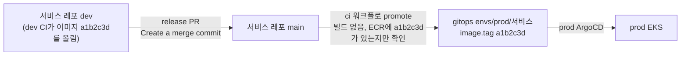

# infra

> FreshLink가 올라가는 **AWS 인프라 전체를 Terraform 코드로** 관리한다. VPC부터 EKS, RDS, SQS, CloudFront까지 명령 한 번으로 만들고 지울 수 있다.

| 항목 | 내용 |
| --- | --- |
| 담당 | 김진아 |
| 관련 기능 ID | I-01 인프라 코드화, I-10 메시징 인프라, I-11 프론트엔드 배포, I-09 비용 알림 |
| 기술 | Terraform 1.11 이상, AWS provider 6.x (ap-northeast-2 서울, AZ 2a·2c) |
| 환경 | dev, prod 두 개. 같은 모듈을 부르고 변수만 다르다 |
| 상태 저장 | S3 `freshlink-tfstate-<계정ID 끝 4자리>`, 루트마다 키 하나(5개), S3 잠금 파일(`use_lockfile`)로 잠금 |
| 브랜치 | `main` ← `feat/I-xx-설명` (dev 브랜치 없음, 환경은 폴더로 나눈다) |

설계 근거와 비용은 `.github` 레포 [`docs/aws-리소스-계획.md`](https://github.com/sesac-freshlink/.github/blob/main/docs/aws-%EB%A6%AC%EC%86%8C%EC%8A%A4-%EA%B3%84%ED%9A%8D.md)에 있다. 이 README와 다르면 그 문서를 따른다.

---

## 1. 무엇이 만들어지나


> 번호별 흐름 설명: [.github 레포 docs/architecture](https://github.com/sesac-freshlink/.github/blob/main/docs/architecture/README.md)

두 환경이 같이 쓰는 것 (`global/`, 만들어 둠)

| 구분 | 리소스 | 비고 |
| --- | --- | --- |
| state | S3 `freshlink-tfstate-<계정ID 끝 4자리>` | 버전 관리, 암호화, 퍼블릭 차단, HTTPS만, 지난 버전 90일 보관, `prevent_destroy` |
| 비용 | AWS Budgets `freshlink-monthly`, 비용 이상 탐지 `freshlink-services` | 10월 160 + 11월 200 = 360 USD. 50·80·100%와 예측 100% 초과 시 메일. 크레딧은 빼고 실제 사용 금액으로 본다 |
| 비용 메일 | Lambda `freshlink-cost-report`, SNS 주제 `freshlink-cost-report`, EventBridge Scheduler 매일 09:00 | 어제 비용·이번 달 누계·총 비용을 매일 아침 세 사람에게 보낸다 (4-9) |
| 이미지 | ECR 5개 (`gateway`, `member-service`, `inventory-service`, `order-service`, `logistics-simulator`) | 태그 덮어쓰기 금지, push 때 스캔, 최근 30개 보관 |
| CI 인증 | GitHub OIDC 공급자 | 이 공급자를 믿는 Role은 할 일 10에서 만든다 |
| 팀원 | IAM 그룹 `freshlink-developers`, 사용자 `freshlink-taewoo`·`freshlink-kyungwoo`·`freshlink-younghoon` | dev 리소스만 (5장) |

환경마다 하나씩 있는 것 (`envs/<env>/`, 할 일 3·9·15에서 채운다)

| 구분 | 리소스 | 크기 |
| --- | --- | --- |
| 컴퓨팅 | EKS `freshlink-<env>-eks` + 관리형 노드 그룹 | t3.large × 2 (최대 3) |
| DB | RDS MySQL 8.4 `freshlink-<env>-mysql` + SSM 접속용 t4g.nano(public-a, 인바운드 없음) | db.t4g.small, gp3 20 GiB, 단일 AZ, 스키마 3개 |
| 메시징 | SQS `<env>-inventory-commands.fifo`, `<env>-inventory-results` + DLQ 2개 (dev는 개발자별 큐 추가) | 3번 실패 시 DLQ |
| 네트워크 | VPC(dev `10.0.0.0/16`, prod `10.1.0.0/16`), 서브넷 6개, NAT 1개, S3 Gateway 엔드포인트 | 앱 서브넷 /20 |
| 프론트 | S3(비공개) + CloudFront(OAC) + CloudFront Function, `/api/*` → gateway ALB | 도메인이 없어 ACM 없이 `https://<id>.cloudfront.net` |
| 보안 | IRSA Role, Secrets Manager + External Secrets Operator, 보안 그룹 | |
| 인증 | Cognito User Pool `freshlink-<env>-users` + 가입 확인 트리거 Lambda | |
| 관측성 | S3 Loki 로그 버킷(14일), Loki IRSA Role, EBS CSI 드라이버 | 스택은 [gitops/platform/observability](https://github.com/sesac-freshlink/gitops/tree/main/platform/observability)에서 ArgoCD가 설치 |

Bastion 서버는 두지 않는다. 노드와 RDS 접속은 SSM Session Manager로 한다.

## 2. 루트 다섯 개와 state 키

| 루트 | state 키 | 리소스 | 주말·평소 |
| --- | --- | --- | --- |
| `global/` | `global/terraform.tfstate` | state 버킷, Budgets, ECR, GitHub OIDC 공급자, 팀원 IAM | 그대로 둔다 |
| `envs/dev/persistent/` | `dev/persistent/terraform.tfstate` | VPC, RDS, nano, Secrets, S3·CloudFront, SQS, Scheduler, Loki 버킷, Cognito | 그대로 둔다 (RDS·nano는 중지) |
| `envs/dev/cluster/` | `dev/cluster/terraform.tfstate` | EKS, 노드 그룹, NAT, Helm 설치물 | 금 21:00 삭제, 월 08:40 생성, 평일 09:00~21:00만 켬 |
| `envs/prod/persistent/` | `prod/persistent/terraform.tfstate` | dev와 같은 모듈, 값만 다름(4-12) | 그대로 둔다 (RDS·nano는 평소 중지) |
| `envs/prod/cluster/` | `prod/cluster/terraform.tfstate` | dev와 같은 모듈 | 평소 없음. 릴리스 확인·리허설·시연 날만 사람이 만들고, 매일 21:05에 지운다 |

의존 방향은 `envs/<env>/cluster` → `envs/<env>/persistent` → `global` 한쪽뿐이다. dev와 prod는 서로를 참조하지 않는다. `cluster`만 지워도 DB 데이터, 이미지, 회원 계정은 남는다. 매주 `destroy`·`apply`를 반복하는 것 자체가 **"코드만으로 인프라를 언제든 똑같이 다시 만들 수 있다"를 매주 검증**하는 일이 된다.

켜고 끄기 (dev, 한국 시각)

| 시각 | 작업 | 도구 |
| --- | --- | --- |
| 월 08:40 | 클러스터 묶음 생성(노드 2대 포함) | EventBridge Scheduler → GitHub Actions |
| 월~금 09:00 | RDS·nano 시작 | EventBridge Scheduler |
| 화·수·목·금 08:50 | NAT 생성 | EventBridge Scheduler → GitHub Actions |
| 화~금 09:10 | 노드 그룹 desired 2 | EventBridge Scheduler |
| 월~목 21:00 | 노드 그룹 desired 0 (+ 월~금 RDS·nano 중지) | EventBridge Scheduler |
| 월~목 21:10 | NAT 삭제 | EventBridge Scheduler → GitHub Actions |
| 금 21:05 | 클러스터 묶음 삭제 | EventBridge Scheduler → GitHub Actions |
| 매일 23:00 / 23:05 | 안전 끄기: RDS·nano 중지·노드 0대 / NAT 삭제 | EventBridge Scheduler / EventBridge Scheduler → GitHub Actions |

"EventBridge Scheduler → GitHub Actions"는 EventBridge가 정해진 시각에 Lambda `freshlink-dev-workflow-dispatch`를 부르고, 그 Lambda가 dev-cluster 워크플로의 **Run workflow**(workflow_dispatch)를 대신 누른다는 뜻이다. Terraform은 그대로 GitHub Actions에서 돈다(4-11).

GitHub 예약(schedule)만 쓰지 않는 이유: 2026-10-20 화 09:00 NAT 생성 예약이 아예 돌지 않았고, 전날 21:10·23:00 NAT 삭제 예약은 03:41·04:34에야 돌았다. GitHub는 붐빌 때 예약 실행을 몇 시간 늦추거나 건너뛴다. 그래서 시각은 EventBridge가 지키고, 워크플로 안의 GitHub 예약(08:50·09:25 NAT 생성, 21:05·22:35 삭제 등, 정각은 피함)은 예비로만 남긴다. 늦게 온 GitHub 예약은 한국 시각을 보고 맞지 않으면 건너뛴다: NAT 생성은 평일 8시부터 20시까지, NAT 삭제는 21시부터 다음 날 8시까지, 클러스터 생성은 월요일 8시부터 20시까지, 삭제는 금요일 21시부터 일요일까지. 같은 일이 두 번 돌아도 바뀌는 것이 없다(한 줄로 서서 돌고, 이미 된 상태면 변경 없음). 자세한 경위는 [트러블슈팅 기록](docs/troubleshooting/2026-10-20-nat-예약-빠짐-노드-안-붙음.md).

켜고 끄기 (prod, 한국 시각). 켜는 예약은 없다. 필요한 날 사람이 dev-cluster 워크플로를 `env=prod`, `create`로 돌린다(RDS·nano도 같이 켠다).

| 시각 | 작업 | 도구 |
| --- | --- | --- |
| 매일 21:00 / 23:00 | RDS·nano 중지 / 한 번 더 (+ 노드 0대) | EventBridge Scheduler |
| 매일 21:05 / 23:05 | 클러스터 묶음 삭제 / 한 번 더 (없으면 그대로) | EventBridge Scheduler → GitHub Actions(prod-cluster) |

prod 삭제는 Lambda `freshlink-prod-workflow-dispatch`가 `prod-cluster` 워크플로를 누르고, 그 워크플로가 dev-cluster 워크플로를 `env=prod`로 부른다. Lambda는 `action` 하나만 넘길 수 있어서 env를 정해 둔 입구를 따로 뒀다. 같은 일을 하는 워크플로는 dev-cluster 하나다.

이유는 [기술스택과 선택이유.md](https://github.com/sesac-freshlink/.github/blob/main/docs/%EA%B8%B0%EC%88%A0%EC%8A%A4%ED%83%9D%EA%B3%BC%20%EC%84%A0%ED%83%9D%EC%9D%B4%EC%9C%A0.md) 3-6.

## 3. 폴더 구조

```
infra/
├── backend.hcl.example  # state 버킷 이름. backend.hcl로 복사해서 쓴다 (커밋 안 함)
├── scripts/             # PowerShell: DB 포트 포워딩, 스키마·앱 사용자 만들기, 토스 키 넣기 (4-4), 시드 (4-5)
├── global/              # 두 환경 공용 루트 (state 버킷, Budgets, 비용 메일, ECR, OIDC, 팀원 IAM)
├── envs/
│   ├── dev/{persistent,cluster}/
│   └── prod/{persistent,cluster}/
└── modules/
    ├── budget/          # Budgets, 비용 이상 탐지, 알림 시험용 예산
    ├── cost-report/     # 매일 아침 비용 메일 (Lambda, SNS 이메일 구독, Scheduler)
    ├── ecr/             # 리포지토리, 보관 개수 정책
    ├── network/         # VPC, 서브넷 6개(EKS 태그), IGW, 라우팅, S3 Gateway 엔드포인트 (NAT는 cluster 묶음)
    ├── rds/             # RDS MySQL 8.4, 보안 그룹, 앱 DB 비밀 3개, SSM 접속용 nano
    ├── scheduler/       # EventBridge Scheduler 켜고 끄기
    ├── messaging/       # SQS 공용 세트 + 개발자별 세트 (각 FIFO·표준·DLQ 2개)
    ├── cognito/         # User Pool, 그룹 3개, 앱 클라이언트, 가입 확인 Lambda, member Cognito 정책, 시드 계정 비밀
    ├── eks/             # EKS, 노드 그룹(desired는 스케줄러 몫), OIDC 공급자, 애드온 4개
    ├── irsa/            # ServiceAccount 하나당 IAM Role 하나 (+ LB Controller 공식 정책 JSON)
    ├── cluster-actions/ # 켜고 끄기 워크플로가 맡는 GitHub OIDC Role (infra main만)
    ├── frontend/
    └── observability/
```

새 리소스 위치: 두 환경이 같이 쓰면 `global`, 주말 동안 남아야 하면 `envs/<env>/persistent`, 시간당 과금이고 다시 만들어도 되면 `envs/<env>/cluster`.

## 할 일: 관측성 (I-03)

- [ ] `modules/observability`: Loki 로그 버킷 `freshlink-<env>-loki-logs-<계정ID 끝 4자리>`, 수명 주기 14일, 퍼블릭 차단 (`envs/<env>/persistent`)
- [ ] `modules/irsa`: `freshlink-<env>-loki-irsa` (위 버킷 읽기·쓰기만), EBS CSI 드라이버 Role
- [x] `envs/<env>/cluster`: EBS CSI 드라이버 애드온·IRSA Role, 기본 `gp3` StorageClass (할 일 7)
- [ ] 만든 버킷 이름·Role ARN을 `gitops/platform/observability/loki.yaml`에 반영

## 할 일: 켜고 끄기 (I-09)

- [x] `modules/scheduler` (`envs/<env>/persistent`, 할 일 3): RDS·nano 일정 6개(평일 09:00 켜기, 평일 21:00 끄기, 매일 23:00 안전 끄기), 시간대 `Asia/Seoul`, universal target `aws-sdk:rds:startDBInstance`·`stopDBInstance`·`ec2:startInstances`·`stopInstances`
- [x] 스케줄러 IAM Role `freshlink-<env>-scheduler-role`: `freshlink-<env>-mysql`과 nano 한 대에 대한 시작·중지만
- [x] 노드 그룹 일정(화·수·목·금 09:10 desired 2, 월·화·수·목 21:00 desired 0, 평일 23:00 desired 0)과 `eks:UpdateNodegroupConfig` 권한 (할 일 7)
- [x] `modules/eks`: 노드 그룹 `scaling_config[0].desired_size`를 `lifecycle { ignore_changes }`에 넣기 (apply가 스케줄러 값을 되돌리지 않게)
- [x] GitHub Actions `.github/workflows/dev-cluster.yml`: 월요일 클러스터 생성, 화·수·목·금 NAT 생성, 월·화·수·목 NAT 삭제, 금요일 클러스터 삭제(Ingress·PVC 먼저 정리), 매일 23:00 NAT 정리, 수동 버튼(workflow_dispatch) (할 일 7)
- [x] prod: 같은 워크플로를 `env=prod`로(수동 버튼의 env, EventBridge용 입구 `prod-cluster.yml`). 켜기 예약 없음, 매일 21:05·23:05 클러스터 삭제, 매일 21:00·23:00 RDS·nano 중지 (할 일 14)

## 할 일: 인증 (Cognito, C-01·C-02·C-03)

- [x] `modules/cognito` (`envs/<env>/persistent`, 할 일 6): `freshlink-<env>-users` (이메일을 아이디로, 이메일 인증, Lite 요금제), 사용자 속성 `custom:storeId`
- [x] 그룹 `OWNER`·`CUSTOMER`·`ADMIN`
- [x] 브라우저용 앱 클라이언트 `freshlink-<env>-web`: 시크릿 없음, `ALLOW_USER_SRP_AUTH`·`ALLOW_REFRESH_TOKEN_AUTH`, ID·액세스 토큰 1시간·리프레시 1일, `custom:storeId`는 읽기 속성에만 (프론트는 ID 토큰을 API에 보낸다)
- [x] 가입 확인 트리거 Lambda `freshlink-<env>-post-confirmation` (Python 3.13): `PostConfirmation_ConfirmSignUp`일 때만 `CUSTOMER`에 넣는다. 화면이 넘기는 역할은 보지 않는다. 실행 Role은 이 User Pool의 `AdminAddUserToGroup`과 자기 로그만
- [x] member-service용 Cognito 관리자 정책 `freshlink-<env>-member-cognito` (이 User Pool만: 계정 만들기·영구 비밀번호·속성·그룹·조회·실패 정리)
- [x] 위 정책을 member-service IRSA Role `freshlink-<env>-member-service-irsa`에 붙이기 (EKS·IRSA를 만드는 클러스터 묶음, 할 일 7)
- [ ] 출력값(User Pool ID, 앱 클라이언트 ID, issuer URI)을 `gitops`의 gateway·member-service values와 frontend 빌드 환경 변수(`VITE_COGNITO_USER_POOL_ID`, `VITE_COGNITO_CLIENT_ID`)에 반영
- [x] 시드 스크립트 (E-12): `scripts/seed-cognito.ps1` 관리자 1·점주 3, `scripts/seed-db.ps1` 점포 3·점주 member 행·상품 30 (4-5)

## 4. 사용법

프로필은 두 가지다. AWS CLI가 액세스 키를 이름 붙여 저장해 두는 칸이 **프로필**이다.

| 프로필 | 누가 | 넣는 키 | 하는 일 |
| --- | --- | --- | --- |
| `freshlink-admin` | 김진아 | 새싹 계정 `sesac-c2` 키 (관리자) | `terraform apply`, 팀원 계정 만들기 |
| `freshlink-dev` | 팀원 3명 | 5-1에서 받은 `freshlink-<이름>` 키 (dev 전용) | 개발 (5-2) |

명령은 `C:\fresh-link\repos\infra`에서 연 PowerShell에서 친다.

### 4-0. 준비 (김진아, 처음 한 번)

```powershell
winget install Hashicorp.Terraform      # 설치 후 터미널을 닫았다 다시 연다
terraform version                       # 1.11 이상

aws configure --profile freshlink-admin
#   AWS Access Key ID:     (sesac-c2 액세스 키, 지금 쓰는 것과 같은 키)
#   AWS Secret Access Key: (sesac-c2 비밀 키)
#   Default region name:   ap-northeast-2
#   Default output format: json

aws sts get-caller-identity --profile freshlink-admin   # "user/sesac-c2"가 나오면 성공
```

`sesac-c2` 키가 기억나지 않으면 `C:\Users\<사용자>\.aws\credentials` 파일의 `[default]` 칸에 있다.

**PowerShell을 새로 열 때마다** 아래 한 줄을 먼저 친다. 그러면 그 창의 `terraform`·`aws` 명령이 모두 관리자 프로필로 돈다.

```powershell
$env:AWS_PROFILE = "freshlink-admin"
```

### 4-1. 맨 처음 한 번: `global` 만들기

state 버킷이 아직 없어서 처음에는 PC에 state를 두고 만든 뒤, 만들어진 버킷으로 옮긴다.

```powershell
$env:AWS_PROFILE = "freshlink-admin"

# 1) 알림 메일 넣기: 열리는 메모장에서 팀원 3명(김진아·이태우·김경우) 메일을 넣고 저장
cd global
Copy-Item terraform.tfvars.example terraform.tfvars
notepad terraform.tfvars

# 2) 만들기: 목록을 보여 주면 yes 입력 (예산이 먼저 만들어진다)
Set-Content backend_override.tf "terraform {`n  backend `"local`" {}`n}"
terraform init
terraform apply "-target=module.budget"   # PowerShell에서는 따옴표가 있어야 한다
terraform apply

# 3) state를 S3로 옮기기: 물으면 yes
$bucket = terraform output -raw tfstate_bucket
Set-Content ..\backend.hcl "bucket = `"$bucket`""
Remove-Item backend_override.tf
terraform init -migrate-state "-backend-config=../backend.hcl"
Remove-Item terraform.tfstate, terraform.tfstate.backup -ErrorAction SilentlyContinue
```

마지막에 `terraform plan`이 `No changes.`를 보이면 끝이다. 새로 생긴 `global/.terraform.lock.hcl`은 커밋한다.

자주 나는 오류

| 오류 | 해결 |
| --- | --- |
| `The config profile (freshlink-admin) could not be found` | 4-0의 `aws configure --profile freshlink-admin`을 아직 안 했다 |
| `No valid credential sources found` | 이 창에서 `$env:AWS_PROFILE = "freshlink-admin"`을 안 쳤다 |
| 비용 이상 탐지에서 `LimitExceeded` | 콘솔 Billing → 비용 이상 탐지에서 기존 모니터를 지우고 다시 `terraform apply` |
| `Error acquiring the state lock` | 다른 터미널에서 같은 폴더를 돌리고 있다. 끝난 뒤 다시 한다 |

### 4-2. 그 다음부터 (모든 루트)

4-1을 마친 뒤 한 번에 끝내는 단계가 아니라, 루트를 다룰 때마다 쓰는 사용법이다. `global`은 4-1에서 init까지 끝났으므로 다른 PC나 새로 clone한 폴더에서만 첫 줄을 친다. `envs/<env>/*`는 해당 할 일(dev persistent는 할 일 3, dev cluster는 할 일 9)에서 코드를 채운 뒤에 한다.

`$env:AWS_PROFILE = "freshlink-admin"`을 친 창에서, `infra` 폴더(레포 맨 위)에서 친다. `-chdir=`가 그 폴더 기준이라 `global` 안에서 치면 `chdir global` 오류가 난다.

```powershell
terraform "-chdir=global" init "-backend-config=../backend.hcl"
terraform "-chdir=envs/dev/persistent" init "-backend-config=../../../backend.hcl"
terraform "-chdir=envs/dev/persistent" plan
```

apply 순서는 `global` → `envs/<env>/persistent` → `envs/<env>/cluster`, dev 먼저다. `cluster`는 `destroy`해도 되지만 `global`과 `persistent`는 지우지 않는다.

`envs/<env>/cluster`를 처음 만들기 전에 두 AZ 모두 t3.large를 지원하는지 확인한다.

```bash
aws ec2 describe-instance-type-offerings --location-type availability-zone \
  --filters Name=instance-type,Values=t3.large --region ap-northeast-2
```

### 4-3. 예산 알림 시험

```powershell
notepad global\terraform.tfvars    # budget_test_alert = true 로 바꾸고 저장
terraform "-chdir=global" apply      # freshlink-alert-test 예산(1 USD, 1% 초과 시 메일) 생성
```

이번 달 실제 사용 금액이 0.01 USD를 넘으면 세 사람에게 메일이 간다. Budgets는 하루 몇 번만 평가하므로 메일까지 몇 시간 걸릴 수 있다. 세 사람이 메일을 받으면 `budget_test_alert = false`로 돌리고 다시 apply해서 시험 예산을 지운다.

- 예산 알림은 기준을 처음 넘는 순간 **한 달에 한 번만** 간다. 시험 예산을 켜 둔 채 기다려도 다음 메일은 다음 달 1일 뒤에야 온다. 다시 시험하려면 `false`로 apply해서 지운 뒤 `true`로 다시 apply한다(새 예산이라 처음부터 다시 평가한다).
- 콘솔 Billing → 예산에서 임계값이 `초과됨`이면 메일은 이미 나갔다. 받은편지함에 없으면 Gmail 검색창에 `in:anywhere "AWS Budgets"`를 쳐서 스팸·프로모션까지 찾는다.
- 매일 비용 메일은 예산 알림과 따로 4-9에서 만든다.

### 4-4. dev 유지 묶음 만들기 (할 일 3, 김진아)

`envs/dev/persistent` apply 한 번으로 아래 64개 리소스가 생긴다. RDS가 뜨는 데 10~15분 걸린다.

| 구분 | 이름 | 비고 |
| --- | --- | --- |
| 네트워크 | VPC `freshlink-dev-vpc` `10.0.0.0/16`, 서브넷 6개, IGW, 라우팅 테이블 3개, S3 Gateway 엔드포인트 | NAT는 없다(할 일 9 cluster 묶음). db 서브넷은 인터넷 경로가 없다 |
| DB | RDS `freshlink-dev-mysql` (MySQL 8.4, db.t4g.small, 단일 AZ) | 관리자 `freshlink_admin`, 비밀번호는 RDS가 만든 비밀 `rds!db-...`에 있다(팀원은 못 읽는다) |
| DB 접속 | EC2 `freshlink-dev-ssm-access` (t4g.nano, public-a, 인바운드 없음) | SSM 포트 포워딩 통로. NAT가 없을 때도 되도록 공인 IP를 붙였다 |
| 비밀 | `freshlink-dev-member-db`, `freshlink-dev-inventory-db`, `freshlink-dev-order-db`, `freshlink-dev-toss` | 앱 DB 비밀번호는 apply가 만들어 넣는다(state에 남지 않음). 토스 키는 아래 4에서 넣는다 |
| 큐 | 공용 `dev-`, 개인 `dev-taewoo-`, `dev-kyungwoo-` 세트마다 `inventory-commands.fifo`·`inventory-commands-dlq.fifo`·`inventory-results`·`inventory-results-dlq` | 3번 받고도 처리 못 한 쪽지는 DLQ로 |
| 켜고 끄기 | 일정 그룹 `freshlink-dev`: RDS·nano 평일 09:00 켜기, 평일 21:00 끄기, 매일 23:00 안전 끄기 | 한국 시각 |

| 스키마 | DB 사용자 | 비밀 | 담당 |
| --- | --- | --- | --- |
| `member` | `member_app` | `freshlink-dev-member-db` | 김경우 |
| `inventory` | `inventory_app` | `freshlink-dev-inventory-db` | 이태우 |
| `orders` | `order_app` | `freshlink-dev-order-db` | 김경우 |

**준비 (처음 한 번).** PowerShell에서 두 프로그램을 설치하고, **창을 닫았다가 새로 연다**(그래야 명령이 잡힌다).

```powershell
winget install --id Amazon.SessionManagerPlugin -e --source winget    # SSM 포트 포워딩에 필요
winget install --id Oracle.MySQLShell -e --source winget              # SQL 실행용 (mysqlsh)

# 새 창에서 확인
session-manager-plugin    # "The Session Manager plugin was installed successfully"가 나오면 성공
mysqlsh --version         # "mysqlsh   Ver 9..."가 나오면 성공
```

**1) 만들기.** `C:\fresh-link\repos\infra`에서 연 PowerShell에서 친다.

```powershell
git pull
$env:AWS_PROFILE = "freshlink-admin"
aws sts get-caller-identity          # "user/sesac-c2"가 나오면 성공

terraform "-chdir=envs/dev/persistent" init "-backend-config=../../../backend.hcl"
#   "Terraform has been successfully initialized!"가 나오면 성공
terraform "-chdir=envs/dev/persistent" apply
#   "Plan: 64 to add, 0 to change, 0 to destroy."를 보고 yes 입력
#   10~15분 뒤 "Apply complete! Resources: 64 added"가 나오면 성공
```

**2) 포트 포워딩 (창 2).** PowerShell 창을 하나 더 열고 친다. 이 창은 3)이 끝날 때까지 닫지 않는다.

```powershell
cd C:\fresh-link\repos\infra
$env:AWS_PROFILE = "freshlink-admin"
powershell -ExecutionPolicy Bypass -File .\scripts\db-port-forward.ps1
#   "Waiting for connections..."가 나오면 성공
```

**3) 스키마 3개·앱 사용자 3개 만들기 (창 1).** 처음 창으로 돌아와 친다.

```powershell
powershell -ExecutionPolicy Bypass -File .\scripts\db-init.ps1
#   마지막에 inventory, member, orders 세 줄과 inventory_app, member_app, order_app 세 줄이 나오면 성공
```

끝나면 창 2에서 `Ctrl+C`로 포트 포워딩을 끈다. 여러 번 돌려도 된다(있으면 건너뛰고 비밀번호만 비밀 값으로 다시 맞춘다).

**4) 토스 테스트 키 넣기.** 토스페이먼츠 개발자센터의 테스트 키 두 개(`test_ck_...`, `test_sk_...`)를 물으면 붙여 넣는다. 키가 아직 없으면 나중에 한다.

```powershell
powershell -ExecutionPolicy Bypass -File .\scripts\set-toss-key.ps1
#   "완료: freshlink-dev-toss 에 테스트 키를 넣었다."가 나오면 성공
```

**5) 팀원에게 줄 값 확인.** 팀원은 같은 값을 SSM 파라미터 `/freshlink/dev/ssm-access-instance-id`·`/freshlink/dev/db-address`에서 직접 읽는다(아래 "팀원 확인"). 따로 전달하지 않아도 된다. 아래 값과 같은지만 본다.

```powershell
terraform "-chdir=envs/dev/persistent" output -raw ssm_access_instance_id; ""   # i-로 시작
terraform "-chdir=envs/dev/persistent" output -raw db_address; ""               # freshlink-dev-mysql....rds.amazonaws.com
```

**6) 21:00에 꺼지는지 확인.** 21:00이 지나고 친다.

```powershell
aws rds describe-db-instances --db-instance-identifier freshlink-dev-mysql --query "DBInstances[0].DBInstanceStatus" --output text
#   "stopping" 또는 "stopped"면 성공
aws scheduler list-schedules --group-name freshlink-dev --query "Schedules[].Name" --output table   # 일정 6개
```

**꺼진 시간에 쓰려면** (21:00 이후·주말). 켜는 데 RDS 5~10분이 걸리고, 23:00 안전 끄기가 다시 끈다.

```powershell
aws rds start-db-instance --db-instance-identifier freshlink-dev-mysql --query "DBInstance.DBInstanceStatus" --output text
aws ec2 start-instances --instance-ids (terraform "-chdir=envs/dev/persistent" output -raw ssm_access_instance_id) --query "StartingInstances[0].CurrentState.Name" --output text
```

| 증상 | 원인과 해결 |
| --- | --- |
| 포트 포워딩 `TargetNotConnected` | nano가 꺼져 있거나 막 켜졌다. 위 "꺼진 시간에 쓰려면"으로 켜고 2~3분 뒤 다시 한다 |
| `SessionManagerPlugin is not found` | 준비 단계 설치 뒤 창을 새로 열지 않았다 |
| `db-init.ps1` `Can't connect to MySQL server` | 창 2 포트 포워딩이 꺼져 있거나 RDS가 꺼져 있다(`DBInstanceStatus`가 `available`이어야 한다) |
| apply `InvalidParameterCombination ... 8.4` | 서울 리전에 8.4 기본 버전이 없을 때다. 오류 문구를 그대로 스레드에 붙여 넣는다 |

#### 팀원 확인 (할 일 3 완료 기준)

이태우·김경우가 각자 PC에서 한다. 5-2를 마쳐 `freshlink-dev` 프로필이 있어야 한다. 준비 단계의 두 프로그램 설치도 같다. 인스턴스 ID·DB 주소는 받아 적지 않는다. nano가 다시 만들어지면 ID가 바뀌므로, 스크립트가 SSM 파라미터 `/freshlink/dev/ssm-access-instance-id`·`/freshlink/dev/db-address`에서 지금 값을 읽는다.

창 1 (포트 포워딩, 열어 둔다). infra 레포를 받은 폴더에서 친다:

```powershell
powershell -ExecutionPolicy Bypass -File .\scripts\db-port-forward.ps1 -AwsProfile freshlink-dev
#   "Waiting for connections..."가 나오면 성공
```

스크립트 없이 직접 치려면 지금 값을 먼저 읽는다:

```powershell
$id = aws ssm get-parameter --name /freshlink/dev/ssm-access-instance-id --query Parameter.Value --output text --profile freshlink-dev
$db = aws ssm get-parameter --name /freshlink/dev/db-address --query Parameter.Value --output text --profile freshlink-dev
aws ssm start-session --profile freshlink-dev --target $id --document-name AWS-StartPortForwardingSessionToRemoteHost --parameters "host=$db,portNumber=3306,localPortNumber=3306"
```

| 증상 | 원인과 해결 |
| --- | --- |
| `start-session`이 `AccessDeniedException ... no identity-based policy allows the ssm:StartSession action` 또는 `TargetNotConnected` (예전에 받은 ID로 칠 때) | nano가 다시 만들어져 그 ID가 없어졌다(없는 인스턴스에는 `Environment=dev` 태그가 없어 거부된다). ID를 적어 두지 말고 위 스크립트나 `get-parameter`로 지금 ID를 읽는다 |
| `get-parameter`가 `AccessDenied` | `--profile freshlink-dev`(스크립트는 `-AwsProfile freshlink-dev`)를 빠뜨렸다 |

창 2 (DB 접속과 큐). 이태우는 `inventory`, 김경우는 `member`(같은 방법으로 `order`도)를 쓴다. 아래는 이태우 예시다.

```powershell
# 내 DB 비밀번호 보기 ("password" 값)
aws secretsmanager get-secret-value --secret-id freshlink-dev-inventory-db --query SecretString --output text --profile freshlink-dev

# 접속: 물으면 위 비밀번호를 붙여 넣는다. 저장할지 물으면 N
mysqlsh --sql "--host=127.0.0.1" "--port=3306" "--user=inventory_app" "--schema=inventory" -e "SHOW DATABASES;"
#   inventory(와 information_schema·performance_schema)만 보이면 성공

# 내 큐로 쪽지 보내고 받기
$q = aws sqs get-queue-url --queue-name dev-taewoo-inventory-results --query QueueUrl --output text --profile freshlink-dev
aws sqs send-message --queue-url $q --message-body "hello" --profile freshlink-dev
aws sqs receive-message --queue-url $q --query "Messages[0].Body" --output text --profile freshlink-dev
#   "hello"가 나오면 성공

# FIFO 큐는 그룹 ID와 중복 제거 ID가 필요하다
$f = aws sqs get-queue-url --queue-name dev-taewoo-inventory-commands.fifo --query QueueUrl --output text --profile freshlink-dev
aws sqs send-message --queue-url $f --message-body "hello-fifo" --message-group-id 1 --message-deduplication-id (Get-Random) --profile freshlink-dev
aws sqs receive-message --queue-url $f --query "Messages[0].Body" --output text --profile freshlink-dev
```

김경우는 `freshlink-dev-member-db`·`member_app`·`member`, `dev-kyungwoo-...` 큐로 바꿔 친다. 서비스 실행 설정은 `QUEUE_PREFIX=dev-taewoo-`(또는 `dev-kyungwoo-`), `DB_URL=jdbc:mysql://127.0.0.1:3306/inventory`처럼 준다(할 일 4 접속 가이드에서 정리).

### 4-5. dev Cognito + 시드 데이터 (할 일 6, 김진아)

`envs/dev/persistent`에 아래 12개 리소스가 더해진다. 비용은 0이다(월간 활성 사용자 1만 명까지 무료, Lambda 무료 사용량 안).

| 구분 | 이름 | 비고 |
| --- | --- | --- |
| User Pool | `freshlink-dev-users` | 이메일이 아이디, 이메일 인증 코드로 가입 확인, 비밀번호 8자 이상·대소문자·숫자·특수문자. 지우기 보호 켜짐 |
| 그룹 | `OWNER`, `CUSTOMER`, `ADMIN` | 토큰 `cognito:groups` |
| 사용자 속성 | `custom:storeId` | 점주의 점포 ID(`"1"`). 앱 클라이언트는 읽기만 |
| 앱 클라이언트 | `freshlink-dev-web` | 시크릿 없음, SRP 로그인 |
| 가입 확인 Lambda | `freshlink-dev-post-confirmation` + Role + 로그 그룹(14일) | 직접 가입하면 `CUSTOMER`. 비밀번호 찾기 확인 때는 아무것도 안 한다 |
| IAM 정책 | `freshlink-dev-member-cognito` | member-service가 점주 계정을 만들 때 쓴다. EKS가 생기는 할 일 7에서 member IRSA Role에 붙인다 |
| 비밀 | `freshlink-dev-seed-accounts` | 시드 계정 4개의 이메일·비밀번호·sub. 값은 2)의 스크립트가 넣는다 |

시드 순서는 member 등록 순서(AD-01)와 같다: ① 점포 3개(ID 1~3, `SEOUL`)를 `PENDING`으로 → ② Cognito 관리자 1·점주 3 → ③ 받은 sub로 점주 member 행 → 점포에 점주 연결 + `ACTIVE`, ④ 상품 30개. ②는 Cognito만 있으면 되고, ①③④는 각 서비스 Flyway가 dev DB에 표를 만든 뒤에 된다. 그래서 스크립트를 둘로 나눴다.

**준비.** 4-4를 끝냈어야 한다(`mysqlsh`, Session Manager 플러그인 설치 포함). 이 PR이 `main`에 합쳐진 뒤 한다.

**1) 만들기.** `C:\fresh-link\repos\infra`에서 연 PowerShell에서 친다.

```powershell
git checkout main
git pull
$env:AWS_PROFILE = "freshlink-admin"
aws sts get-caller-identity          # "user/sesac-c2"가 나오면 성공

terraform "-chdir=envs/dev/persistent" init "-backend-config=../../../backend.hcl"
#   "Terraform has been successfully initialized!"가 나오면 성공 (archive 프로바이더를 새로 받는다)
terraform "-chdir=envs/dev/persistent" apply
#   "Plan: 12 to add, 0 to change, 0 to destroy."를 보고 yes 입력
#   1분쯤 뒤 "Apply complete! Resources: 12 added"가 나오면 성공
```

**2) Cognito 시드 계정 (②).** 같은 창에서 친다. RDS가 꺼져 있어도 된다.

```powershell
powershell -ExecutionPolicy Bypass -File .\scripts\seed-cognito.ps1
#   마지막 표에 admin@freshlink.test(ADMIN), owner1~3@freshlink.test(OWNER, storeId 1~3) 네 줄과 sub가 나오면 성공
```

- 메일은 보내지 않는다(`.test` 주소는 받을 수 없다). 이메일 인증 완료·영구 비밀번호로 만들어서 바로 로그인할 수 있다.
- 비밀번호를 볼 때(관리자·점주 로그인 시험용). 팀원도 `--profile freshlink-dev`로 볼 수 있다.

```powershell
aws secretsmanager get-secret-value --secret-id freshlink-dev-seed-accounts --query SecretString --output text
```

- 여러 번 돌려도 된다. 비밀번호는 바뀌지 않는다.

**3) 김경우·이태우에게 줄 값.** gateway·member-service 설정과 프론트 환경 변수(`VITE_COGNITO_USER_POOL_ID`, `VITE_COGNITO_CLIENT_ID`)에 쓴다. 공개해도 되는 값이다.

```powershell
terraform "-chdir=envs/dev/persistent" output -raw cognito_user_pool_id; ""    # ap-northeast-2_로 시작
terraform "-chdir=envs/dev/persistent" output -raw cognito_app_client_id; ""   # 영문·숫자 26자쯤
terraform "-chdir=envs/dev/persistent" output -raw cognito_issuer_uri; ""      # https://cognito-idp.ap-northeast-2.amazonaws.com/ap-northeast-2_...
```

**4) 가입 확인 트리거 시험.** 내 실제 메일 주소로 고객 가입을 한 번 해 보고 지운다. `<내 메일>`과 `<비밀번호>`(대소문자·숫자·특수문자 포함 8자 이상)를 바꿔 친다.

```powershell
$client = terraform "-chdir=envs/dev/persistent" output -raw cognito_app_client_id
$pool   = terraform "-chdir=envs/dev/persistent" output -raw cognito_user_pool_id
aws cognito-idp sign-up --client-id $client --username "<내 메일>" --password "<비밀번호>" --user-attributes "Name=email,Value=<내 메일>"
#   "UserConfirmed": false 가 나오고, 메일로 6자리 코드가 온다
aws cognito-idp confirm-sign-up --client-id $client --username "<내 메일>" --confirmation-code "<받은 코드>"
aws cognito-idp admin-list-groups-for-user --user-pool-id $pool --username "<내 메일>" --query "Groups[].GroupName" --output text
#   CUSTOMER 가 나오면 성공
aws cognito-idp admin-delete-user --user-pool-id $pool --username "<내 메일>"    # 시험 계정 지우기
```

**5) DB 시드 (①③④).** 김경우의 member Flyway V1, 이태우의 inventory Flyway V1이 dev DB에 돈 뒤에 한다(서비스를 dev DB에 붙여 한 번 띄우면 돈다). 평일 09:00~21:00(RDS가 켜진 시간)에 한다.

창 2 (포트 포워딩, 끝날 때까지 열어 둔다):

```powershell
cd C:\fresh-link\repos\infra
$env:AWS_PROFILE = "freshlink-admin"
powershell -ExecutionPolicy Bypass -File .\scripts\db-port-forward.ps1 -LocalPort 3307
#   "Waiting for connections..."가 나오면 성공
```

창 1, 먼저 표가 생겼는지 본다:

```powershell
cd C:\fresh-link\repos\infra
$env:AWS_PROFILE = "freshlink-admin"
$out = (terraform -chdir=envs\dev\persistent output -json | Out-String) | ConvertFrom-Json
$m = (aws secretsmanager get-secret-value --secret-id $out.master_user_secret_arn.value --query SecretString --output text) | ConvertFrom-Json
mysqlsh --sql --host=127.0.0.1 --port=3307 "--user=$($m.username)" "--password=$($m.password)" -e "SELECT table_schema, table_name FROM information_schema.tables WHERE table_schema IN ('member','inventory','orders') ORDER BY 1,2;"
```

| 결과 | 뜻 |
| --- | --- |
| 아무 행도 없음 | 아직 누구도 서비스를 dev DB에 붙여 띄우지 않았다. 시드는 기다린다 |
| `member`에 `flyway_schema_history`·`store`·`member` | 김경우의 member V1이 돌았다 |
| `inventory`에 `flyway_schema_history`·`product` | 이태우의 inventory V1이 돌았다 |

`flyway_schema_history`는 Flyway가 실제로 돌았다는 표시다. 이 확인을 건너뛰어도 아래 `seed-db.ps1`이 같은 확인을 먼저 하고, 표가 없으면 멈춘다.

창 1, 시드를 넣는다:

```powershell
powershell -ExecutionPolicy Bypass -File .\scripts\seed-db.ps1 -LocalPort 3307
#   점포 1~3이 S1~S3·ACTIVE·owner1~3 이메일과 함께 나오고, product_count 30이 나오면 성공
```

- 표가 아직 없거나 칼럼이 시드와 다르면 `멈춤:`과 이유 목록을 보여 주고 **아무것도 넣지 않는다.** 그 목록을 스레드에 붙여 넣는다.
- 한쪽만 준비됐으면 그쪽만 넣는다: 상품만 `-Part inventory`, 점포·점주만 `-Part member`.
- 여러 번 돌려도 된다. 끝나면 창 2에서 `Ctrl+C`.
- 재고 lot은 넣지 않는다. logistics-simulator 입고(INBOUND)로 생긴다.

**완료 기준 (할 일 6).** 프론트에서 dev Cognito 가입·로그인이 되고 ID 토큰에 `cognito:groups`가 있다. 점주 시드 계정으로 로그인된다. 프론트가 아직 없으면 4)까지로 트리거를 확인하고, 로그인은 프론트 연결 때 시드 계정으로 확인한다.

| 증상 | 원인과 해결 |
| --- | --- |
| apply `Inconsistent dependency lock file` | `init`을 다시 친다(새 archive 프로바이더) |
| `seed-cognito.ps1` "cognito_user_pool_id가 없다" | 1)의 apply가 안 끝났다 |
| `sign-up` `InvalidPasswordException` | 비밀번호 규칙(8자 이상, 대소문자·숫자·특수문자) |
| `sign-up` 뒤 메일이 안 온다 | 스팸함을 본다. Cognito 기본 메일은 하루 50통까지다 |
| `seed-db.ps1` `Can't connect to MySQL server` | 창 2 포트 포워딩이 꺼져 있거나 RDS가 꺼져 있다 |
| `seed-db.ps1` "sub가 비밀에 없다" | 2)를 먼저 돌린다 |

### 4-6. dev 클러스터 만들기 (할 일 7, 김진아)

`envs/dev/cluster`에 아래가 생긴다. RDS·SSM 접속용 인스턴스는 **꺼져 있어도 된다**(클러스터는 DB에 붙지 않는다. RDS 보안 그룹 규칙만 더한다).

| 구분 | 이름 | 비고 |
| --- | --- | --- |
| 네트워크 | NAT Gateway `freshlink-dev-nat` + EIP (public-a), app 라우팅 테이블 `0.0.0.0/0` 경로 | 밤에는 워크플로가 지운다 |
| EKS | `freshlink-dev-eks` (Kubernetes 1.36, 표준 지원만), 노드 그룹 `freshlink-dev-nodes` t3.large 2대(최소 0, 최대 3) | 관리자: `sesac-c2`, 워크플로 Role |
| 애드온 | VPC CNI, kube-proxy, CoreDNS, EBS CSI 드라이버 | 버전은 1.36 기본값 |
| IRSA Role | `freshlink-dev-<이름>-irsa`: member-service(Cognito 정책), inventory-service·order-service·logistics-simulator(공용 `dev-` 큐 중 자기 것만), aws-load-balancer-controller, ebs-csi-driver, external-secrets(앱 DB 비밀 3개·토스 키만) | gateway는 AWS를 부르지 않아 없다 |
| Helm | ArgoCD 10.10.5, AWS Load Balancer Controller 3.6.0, metrics-server 3.14.0, External Secrets Operator 2.13.0 | 관측성·앱은 ArgoCD가 설치한다(할 일 9) |
| 기타 | 기본 StorageClass `gp3`, RDS 보안 그룹에 EKS → 3306 | |

`envs/dev/persistent`에는 노드 그룹 일정 3개(화·수·목·금 09:10 2대, 월·화·수·목 21:00 0대, 평일 23:00 0대)와 워크플로 Role `freshlink-dev-cluster-actions`가 더해진다.

비용: 켜져 있는 동안 시간당 약 0.37 USD(EKS 0.10, 노드 2대 0.21, NAT 0.06). 일정대로 돌면 aws-리소스-계획.md 6-6 D안(약 195 USD) 안이다.

**준비 (처음 한 번).** kubectl을 설치하고 창을 새로 연다.

```powershell
winget install --id Kubernetes.kubectl -e --source winget
# 새 창에서
kubectl version --client    # "Client Version: v1..."이 나오면 성공
```

**1) 유지 묶음에 일정·Role 더하기.** 이 PR이 `main`에 합쳐진 뒤, `C:\fresh-link\repos\infra`에서 연 PowerShell에서 친다.

```powershell
git checkout main
git pull
$env:AWS_PROFILE = "freshlink-admin"
aws sts get-caller-identity          # "user/sesac-c2"가 나오면 성공

terraform "-chdir=envs/dev/persistent" init "-backend-config=../../../backend.hcl"
#   "Terraform has been successfully initialized!"가 나오면 성공 (새 모듈 cluster-actions를 읽는다)
terraform "-chdir=envs/dev/persistent" apply
#   "Plan: 7 to add, 2 to change, 0 to destroy."를 보고 yes 입력
#   (바뀌는 2개는 스케줄러 Role 설명과 권한. 노드 그룹 수 바꾸기 권한이 더해진다)
#   "Apply complete! Resources: 7 added, 2 changed"가 나오면 성공
```

**2) 클러스터 만들기.** 같은 창에서 친다. 15~20분 걸린다.

```powershell
aws ec2 describe-instance-type-offerings --location-type availability-zone --filters Name=instance-type,Values=t3.large --query "InstanceTypeOfferings[].Location" --output text
#   ap-northeast-2a 와 ap-northeast-2c 가 둘 다 보이면 성공

terraform "-chdir=envs/dev/cluster" init "-backend-config=../../../backend.hcl"
#   "Terraform has been successfully initialized!"가 나오면 성공
terraform "-chdir=envs/dev/cluster" apply
#   "Plan: 46 to add, 0 to change, 0 to destroy."를 보고 yes 입력
#   15~20분 뒤 "Apply complete! Resources: 46 added"가 나오면 성공
```

**3) ArgoCD 확인.** 같은 창에서 친다.

```powershell
aws eks update-kubeconfig --name freshlink-dev-eks --region ap-northeast-2
kubectl get nodes                  # 두 줄이 STATUS Ready면 성공
kubectl -n argocd get pods         # 모두 Running이면 성공

# 처음 비밀번호 (아이디 admin)
[Text.Encoding]::UTF8.GetString([Convert]::FromBase64String((kubectl -n argocd get secret argocd-initial-admin-secret -o jsonpath="{.data.password}")))

kubectl -n argocd port-forward svc/argocd-server 8443:443
#   "Forwarding from 127.0.0.1:8443"이 나오면 브라우저에서 https://localhost:8443 을 연다
#   인증서 경고는 "고급 → 계속"으로 넘긴다. admin / 위 비밀번호로 로그인되면 성공. 창에서 Ctrl+C로 끝낸다
```

**4) 워크플로에 Role 알려 주기.** 값을 복사한다.

```powershell
terraform "-chdir=envs/dev/persistent" output -raw cluster_actions_role_arn | Set-Clipboard
```

1. 브라우저에서 https://github.com/sesac-freshlink/infra/settings/secrets/actions 를 연다.
2. **New repository secret**을 누른다.
3. Name에 `AWS_DEV_CLUSTER_ROLE_ARN`을 넣고, Secret에 Ctrl+V로 붙여 넣는다.
4. **Add secret**을 누른다.

**5) 수동 버튼으로 지우기 → 만들기 시험.** (할 일 7 완료 기준)

1. https://github.com/sesac-freshlink/infra/actions/workflows/dev-cluster.yml 을 연다.
2. **Run workflow** → action `destroy` → **Run workflow**. 15분쯤 걸린다.
3. 끝난 작업을 눌러 요약 표가 전부 "없음"이고 초록색이면 성공(남은 ALB·ENI·EBS 없음).
4. 다시 **Run workflow** → action `create`. 20분쯤 뒤 요약에 "ArgoCD 준비됨"이 나오면 성공.
5. 3)의 `kubectl -n argocd get pods`로 다시 확인한다.

주말에 시험했으면 끝나고 `destroy`를 한 번 더 돌려 둔다. 월요일 08:40에 워크플로가 다시 만든다.

**밤(21:10 이후)에 사람이 apply할 때**는 NAT를 다시 만들지 않게 `-var nat_enabled=false`를 붙인다. 낮에는 붙이지 않는다.

```powershell
terraform "-chdir=envs/dev/cluster" apply "-var=nat_enabled=false"
```

| 증상 | 원인과 해결 |
| --- | --- |
| cluster apply `Unable to find remote state` | 1)의 persistent apply가 안 끝났거나 `init`의 `backend.hcl`이 없다 |
| `kubectl` `the server has asked for the client to provide credentials` | `AWS_PROFILE`이 `freshlink-admin`이 아니다. 2)의 창에서 친다 |
| 노드 그룹 `CREATE_FAILED` `NodeCreationFailure` | NAT 경로가 없다. 밤에 `nat_enabled=false`로 만들었는지 본다 |
| 워크플로 `Could not assume role` | 4)의 비밀 이름·값을 다시 넣는다. `main`이 아닌 브랜치에서 돌리면 거부된다. 레포 OIDC sub 형식이 바뀌었으면 `modules/cluster-actions` `github_sub_prefixes`를 맞춘다 |
| 워크플로 요약 표에 남은 것이 있다 | 표의 ID를 스레드에 붙여 넣는다. ALB가 남았으면 다시 `destroy`를 돌린다 |
| dev `/api` 전체 503, `kubectl get nodes`가 비어 있는데 노드 그룹 desiredSize는 2 | NAT가 없을 때 노드가 떠서 EKS API·ECR에 닿지 못해 클러스터에 붙지 못했다. NAT를 켠 뒤(`nat-on`) `aws ec2 describe-instances --filters "Name=tag:eks:nodegroup-name,Values=freshlink-dev-nodes" "Name=instance-state-name,Values=running" --query "Reservations[].Instances[].InstanceId" --output text`로 나온 인스턴스를 `aws ec2 terminate-instances --instance-ids <ID들>`로 지우면 노드 그룹이 새로 띄워 3~5분 안에 붙는다 ([기록](docs/troubleshooting/2026-10-20-nat-예약-빠짐-노드-안-붙음.md)) |
| 워크플로 `Error acquiring the state lock` (`PreconditionFailed`) | 앞선 작업이 terraform 도중 취소돼 잠금 파일이 남았다. 로그 `Lock Info`의 `ID`를 복사해 action `unlock`, `lock_id`에 붙여 넣고 돌린 뒤 원래 작업을 다시 돌린다 ([기록](docs/troubleshooting/2026-10-17-dev-cluster-state-잠금-남음.md)) |

### 4-7. CI·dev 배포·gateway 확인 (할 일 8·9·10, 김진아)

이 PR과 `.github`·`gitops`·서비스 레포 PR로 아래가 생긴다.

| 위치 | 생기는 것 |
| --- | --- |
| `global` | Role `freshlink-ci-ecr-push`: 서비스 레포 5개의 `dev`·`main` 브랜치 GitHub Actions만 맡을 수 있고, ECR 5개에 이미지를 올리는 권한만 있다 |
| `envs/dev/persistent` | dev 앱 클라이언트에 `ALLOW_ADMIN_USER_PASSWORD_AUTH` (관리자 IAM 자격으로만 쓰는 로그인 방식. 아래 6)에서 시험 토큰을 받는다) |
| `envs/dev/cluster` | ArgoCD에 `root` Application 등록(`charts/argocd-root`). ECR 주소·IRSA Role ARN·Cognito 값을 넘기고, 나머지는 gitops `argocd/apps`가 만든다 |

흐름: 서비스 레포 `dev`에 합치기 → Actions(`.github` 레포 `spring-build.yml`) 빌드·테스트 → ECR `<서비스>:<커밋 7자리>` → gitops `envs/dev/<서비스>/values.yaml` 태그 커밋 → dev ArgoCD → 파드.

**1) AWS에 적용.** 이 PR이 `main`에 합쳐진 뒤 `C:\fresh-link\repos\infra`에서 연 PowerShell에서 친다. 클러스터는 꺼져 있어도 된다.

```powershell
git checkout main
git pull
$env:AWS_PROFILE = "freshlink-admin"
aws sts get-caller-identity          # "user/sesac-c2"가 나오면 성공

terraform "-chdir=global" apply
#   "Plan: 2 to add, 0 to change, 0 to destroy."를 보고 yes 입력 (Role과 그 권한. 다른 줄이 보이면 no 하고 스레드에 붙여 넣는다)
terraform "-chdir=global" output -raw ci_ecr_push_role_arn
#   arn:aws:iam::929523582720:role/freshlink-ci-ecr-push 가 나오면 성공 (spring-build.yml 기본값과 같아야 한다)

terraform "-chdir=envs/dev/persistent" apply
#   "Plan: 0 to add, 1 to change, 0 to destroy."를 보고 yes 입력 (앱 클라이언트 로그인 방식. 다른 줄이 보이면 no 하고 스레드에 붙여 넣는다)
```

**2) gitops 쓰기 키 만들기.** CI가 gitops에 태그를 커밋할 때 쓴다. 같은 창에서 친다.

```powershell
ssh-keygen -t ed25519 -C "freshlink-ci" -f "$HOME\freshlink-gitops-key"
#   비밀번호를 두 번 물으면 아무것도 치지 말고 Enter 두 번
Get-Content "$HOME\freshlink-gitops-key.pub" | Set-Clipboard
```

1. https://github.com/sesac-freshlink/gitops/settings/keys 를 열고 **Add deploy key**를 누른다.
2. Title `freshlink-ci`, Key에 Ctrl+V, **Allow write access**에 체크하고 **Add key**를 누른다.

```powershell
Get-Content "$HOME\freshlink-gitops-key" -Raw | Set-Clipboard
```

3. https://github.com/organizations/sesac-freshlink/settings/secrets/actions 를 열고 **New organization secret**을 누른다.
4. Name `GITOPS_DEPLOY_KEY`, Value에 Ctrl+V.
5. Repository access는 **Selected repositories**를 고르고 톱니바퀴를 눌러 gateway, member-service, inventory-service, order-service, logistics-simulator 다섯 개에 체크한 뒤 **Add secret**을 누른다.

```powershell
Remove-Item "$HOME\freshlink-gitops-key*"    # PC에 남기지 않는다
```

**3) common 패키지 읽기 허용.** member·inventory·order의 빌드가 `com.freshlink:common`을 받는다.

1. https://github.com/orgs/sesac-freshlink/packages 에서 `com.freshlink.common`을 누른다.
2. 오른쪽 아래 **Package settings** → **Manage Actions access** → **Add Repository**.
3. member-service, inventory-service, order-service를 더하고 Role을 **Read**로 둔다.

**4) 서비스 PR 합치기.** gateway, logistics-simulator, member-service, inventory-service, order-service의 CI PR을 `dev`에 합친다. 합치는 순간 각 레포 Actions의 `ci`가 돈다.

- https://github.com/sesac-freshlink/gitops/commits/main 에 `chore(<서비스>): image <7자리>` 커밋이 5개 생기면 성공
- 실패하면 해당 레포 Actions의 `ci` 실행을 누르고, 빨간 단계 이름을 스레드에 붙여 넣는다

**5) RDS·접속용 인스턴스 켜고 클러스터 만들기.** (주말·밤에 확인할 때. 평일 낮에는 이미 켜져 있다)

```powershell
aws rds start-db-instance --db-instance-identifier freshlink-dev-mysql --query "DBInstance.DBInstanceStatus" --output text
#   "starting"이 나오면 성공 (5분쯤 걸린다)
aws ec2 start-instances --instance-ids (terraform "-chdir=envs/dev/persistent" output -raw ssm_access_instance_id) --query "StartingInstances[0].CurrentState.Name" --output text
#   "pending"이 나오면 성공
```

1. https://github.com/sesac-freshlink/infra/actions/workflows/dev-cluster.yml → **Run workflow** → action `create` → **Run workflow**.
2. 20분쯤 뒤 요약에 "ArgoCD 준비됨"이 나오면 성공.

**6) 할 일 9 확인: 서비스 5개 Synced·Healthy.** 클러스터가 생기고 5분쯤 기다린 뒤 친다.

```powershell
aws eks update-kubeconfig --name freshlink-dev-eks --region ap-northeast-2
kubectl -n argocd get applications
#   root, gateway, member-service, inventory-service, order-service, logistics-simulator 여섯 줄이
#   SYNC STATUS Synced, HEALTH STATUS Healthy면 성공 (Progressing이면 2분 뒤 다시)
kubectl -n freshlink get pods -o custom-columns="NAME:.metadata.name,IMAGE:.spec.containers[0].image,READY:.status.containerStatuses[0].ready"
#   파드 8개가 READY true이고, IMAGE 끝이 :latest가 아닌 7자리면 성공
```

**7) 할 일 10 확인: dev에서 401·403.** 같은 창에서 친다.

```powershell
# ALB는 CloudFront에서 오는 요청만 받는다(4-10). 그래서 ALB 주소가 아니라 CloudFront 주소의 /api로 시험한다
$base = terraform "-chdir=envs/dev/persistent" output -raw frontend_url
$base                                 # https://xxxx.cloudfront.net 이 나오면 성공. 4-8의 3(api-origin)이 끝나 있어야 한다

$pool   = terraform "-chdir=envs/dev/persistent" output -raw cognito_user_pool_id
$client = terraform "-chdir=envs/dev/persistent" output -raw cognito_app_client_id
$seed   = aws secretsmanager get-secret-value --secret-id freshlink-dev-seed-accounts --query SecretString --output text | ConvertFrom-Json
function Get-IdToken($email) {
    $pw = ($seed | Where-Object email -eq $email).password
    @{ USERNAME = $email; PASSWORD = $pw } | ConvertTo-Json -Compress | Set-Content "$env:TEMP\auth.json" -Encoding ascii
    $t = aws cognito-idp admin-initiate-auth --user-pool-id $pool --client-id $client --auth-flow ADMIN_USER_PASSWORD_AUTH --auth-parameters "file://$env:TEMP\auth.json" --query AuthenticationResult.IdToken --output text
    Remove-Item "$env:TEMP\auth.json"
    $t
}
$owner = Get-IdToken "owner1@freshlink.test"
$admin = Get-IdToken "admin@freshlink.test"

curl.exe -s -o NUL -w '%{http_code}\n' "$base/api/members/me"                                             # 401 (토큰 없음)
curl.exe -s -o NUL -w '%{http_code}\n' -H "Authorization: Bearer x.y.z" "$base/api/members/me"            # 401 (가짜 토큰)
curl.exe -s -o NUL -w '%{http_code}\n' -H "Authorization: Bearer $owner" "$base/api/admin/stores"         # 403 (점주가 관리자 경로)
curl.exe -s -o NUL -w '%{http_code}\n' -H "Authorization: Bearer $admin" "$base/api/owner/inventory"      # 403 (관리자가 점주 경로)
curl.exe -s -o NUL -w '%{http_code}\n' -H "Authorization: Bearer $owner" "$base/api/owner/inventory"      # 401·403이 아니면 성공 (gateway 통과. 서비스에 기능이 아직 없으면 404)
curl.exe -s -o NUL -w '%{http_code}
' "$base/actuator/health"                                           # 200이고 내용은 프론트 화면(index.html). /api가 아니라서 gateway로 가지 않는다
```

위조 헤더(`X-User-Id` 등)가 서비스에 닿지 않는지는 gateway 테스트가 확인한다(4)의 gateway `ci`가 초록이면 통과).

**8) 끝나면 끄기 (주말).** dev-cluster 워크플로를 action `destroy`로 돌린다. RDS·접속용 인스턴스는 매일 23:00에 저절로 꺼진다. 바로 끄려면:

```powershell
aws rds stop-db-instance --db-instance-identifier freshlink-dev-mysql --query "DBInstance.DBInstanceStatus" --output text
aws ec2 stop-instances --instance-ids (terraform "-chdir=envs/dev/persistent" output -raw ssm_access_instance_id) --query "StoppingInstances[0].CurrentState.Name" --output text
```

| 증상 | 원인과 해결 |
| --- | --- |
| 서비스 `ci`가 `Could not assume role` | 1)의 global apply가 안 됐거나 `dev`가 아닌 브랜치에서 돌렸다 |
| 서비스 `ci` 빌드에서 `401 Unauthorized` (maven.pkg.github.com) | 3)의 패키지 읽기 허용이 빠졌다 |
| `gitops 받기`·`gitops dev 태그 커밋`에서 `Permission denied (publickey)` | 2)의 deploy key 쓰기 체크나 조직 비밀의 레포 선택이 빠졌다 |
| Application이 `Unknown`, 메시지 `image.tag가 필요하다` | 그 서비스의 `ci`가 아직 gitops에 태그를 커밋하지 않았다(4) |
| 파드가 `CrashLoopBackOff` (member·inventory·order) | RDS가 꺼져 있다(5). `kubectl -n freshlink logs deploy/<서비스>`로 확인 |
| `get-secret-value`가 `AccessDenied` | 이 창에서 `$env:AWS_PROFILE = "freshlink-admin"`을 안 쳤다 |
| `admin-initiate-auth`가 `Auth flow not enabled for this client` | 1)의 persistent apply를 안 했다 |

### 4-8. dev 프론트 배포 (할 일 13, 김진아)

이 PR과 `frontend` 레포 PR(`frontend-deploy.yml`)로 아래가 생긴다.

| 위치 | 생기는 것 |
| --- | --- |
| `envs/dev/persistent` (`modules/frontend`) | S3 `freshlink-dev-frontend-<계정ID 끝 4자리>`(비공개, CloudFront만 읽음), CloudFront 배포(comment `freshlink-dev-frontend`), SPA 경로 Function, `/api/*` 캐시 정책, 배포 Role `freshlink-dev-frontend-deploy`(frontend 레포 `dev` 브랜치만, 이 버킷 쓰기와 무효화만) |
| `scripts/sync-api-origin.sh` | CloudFront `/api/*` 오리진을 지금 gateway ALB 주소로 바꾼다 |
| `.github/workflows/dev-cluster.yml` | `create` 끝에 위 스크립트를 돌리고, 수동 버튼 `api-origin`(오리진만 맞추기)이 생긴다 |

- ALB는 클러스터를 만들 때마다 주소가 바뀐다. 그래서 `/api/*` 오리진 주소는 Terraform이 아니라 스크립트가 맞추고, Terraform은 그 칸을 무시한다(`ignore_changes`). 클러스터가 없을 때 `/api/*`는 버킷 주소를 가리켜 403이 난다.
- 비용: CloudFront·S3 요청 비용뿐이다(시간당 과금 없음). 이 규모면 한 달 1 USD 아래다.
- ALB는 CloudFront 오리진용 접두사 목록에서 오는 요청만 받는다(4-10). 인터넷에서 ALB 주소로 바로 오면 막힌다.

**1) AWS에 적용.** 이 PR이 `main`에 합쳐진 뒤 `C:\fresh-link\repos\infra`에서 연 PowerShell에서 친다. 클러스터는 꺼져 있어도 된다.

```powershell
git checkout main
git pull
$env:AWS_PROFILE = "freshlink-admin"
aws sts get-caller-identity          # "user/sesac-c2"가 나오면 성공

terraform "-chdir=envs/dev/persistent" apply
#   "Plan: 11 to add, 0 to change, 0 to destroy."를 보고 yes 입력 (다른 줄이 보이면 no 하고 스레드에 붙여 넣는다)
#   CloudFront 배포가 퍼지는 데 5~10분 걸린다. "Apply complete! Resources: 11 added"가 나오면 성공
terraform "-chdir=envs/dev/persistent" output -raw frontend_url
#   https://xxxxxxxx.cloudfront.net 이 나오면 성공. 이 주소를 팀에 알린다
```

**2) frontend 레포에 배포 값 넣기.** 같은 창에서 친다. `gh auth status`가 로그인되어 있어야 한다.

```powershell
$p = "envs/dev/persistent"
$r = "sesac-freshlink/frontend"
gh variable set DEV_FRONTEND_BUCKET          --repo $r --body (terraform "-chdir=$p" output -raw frontend_bucket)
gh variable set DEV_FRONTEND_DISTRIBUTION_ID --repo $r --body (terraform "-chdir=$p" output -raw frontend_distribution_id)
gh variable set DEV_FRONTEND_DEPLOY_ROLE_ARN --repo $r --body (terraform "-chdir=$p" output -raw frontend_deploy_role_arn)
gh variable set DEV_COGNITO_USER_POOL_ID     --repo $r --body (terraform "-chdir=$p" output -raw cognito_user_pool_id)
gh variable set DEV_COGNITO_CLIENT_ID        --repo $r --body (terraform "-chdir=$p" output -raw cognito_app_client_id)
gh variable list --repo $r
#   DEV_로 시작하는 줄 5개가 나오면 성공
```

**3) `/api/*`를 지금 클러스터의 ALB로 맞추기.** 클러스터가 있을 때만 한다. 월요일 자동 생성 때는 워크플로가 알아서 한다.

```powershell
gh workflow run dev-cluster.yml --repo sesac-freshlink/infra -f action=api-origin
gh run watch --repo sesac-freshlink/infra (gh run list --repo sesac-freshlink/infra --workflow dev-cluster.yml --limit 1 --json databaseId --jq ".[0].databaseId")
#   초록 체크로 끝나고 요약에 "CloudFront ... /api/* 오리진: ... → k8s-freshlin-gateway-...elb.amazonaws.com"이 나오면 성공
```

**4) frontend PR 합치기.** `frontend` 레포의 `frontend-deploy` PR을 `dev`에 합친다. 합치는 순간 Actions `frontend-deploy`가 돌고 dev 버킷에 올린다.

- https://github.com/sesac-freshlink/frontend/actions 에서 `frontend-deploy`가 초록 체크면 성공
- 빨간 X면 실행을 누르고 빨간 단계 이름을 스레드에 붙여 넣는다

**5) 확인.**

```powershell
$url = terraform "-chdir=envs/dev/persistent" output -raw frontend_url
(Invoke-WebRequest "$url/owner/inventory").StatusCode
#   200이 나오면 성공 (SPA 경로도 index.html을 준다)
try { Invoke-RestMethod "$url/api/members/me" } catch { $_.Exception.Response.StatusCode.value__ }
#   401이 나오면 성공 (토큰 없이 CloudFront → ALB → gateway까지 닿았다)
#   502·504면 3)을 다시 하고, 403이면 아직 오리진이 버킷을 가리키는 것이다
```

브라우저로 주소를 열어 점주 시드 계정으로 로그인되면 할 일 13의 배포 부분이 끝난다.

### 4-9. 매일 아침 비용 메일 (김진아)

매일 09:00(한국 시간)에 `alert_emails`의 세 사람에게 아래 메일이 간다. 주말에도 간다.

```
제목: [FreshLink 비용] 10/19 US$1.23 · 총 US$5.88
어제(2026-10-19) 비용: US$1.23
10월 누계(10/01~10/19): US$5.88 / 예산 US$160.00 (3.7%)
총 비용(2026-10-01부터): US$5.88 / 지원금 US$360.00 (1.6%)
어제 많이 쓴 서비스 (상위 5): ...
```

| 위치 | 생기는 것 |
| --- | --- |
| `global` (`modules/cost-report`) | Lambda `freshlink-cost-report`(Python 3.13, Cost Explorer 읽기와 아래 주제 보내기만), SNS 주제 `freshlink-cost-report`와 메일 구독 3개, EventBridge Scheduler 일정 `freshlink-cost-report`(`cron(0 9 * * ? *)`, `Asia/Seoul`)와 그 Role, 로그 그룹(14일) |

- Cost Explorer의 하루는 UTC다. 09:00에 보내야 어제 하루(한국 시간 어제 09:00~오늘 09:00)가 끝나 있다. Cost Explorer는 최대 하루 늦게 채워져서 어제 값은 다음 날 메일에서 조금 늘 수 있다.
- 금액은 크레딧·환불을 뺀 실제 사용 금액이다(예산과 같은 기준). 총 비용은 `monthly_budget_usd`의 첫 달 1일부터 센다.
- 비용: Cost Explorer API 한 번에 0.01 USD, 하루 2번이라 한 달 0.6 USD쯤이다. Lambda·SNS·Scheduler는 무료 한도 안이다.
- 받는 사람을 바꾸려면 `terraform.tfvars`의 `alert_emails`를 고치고 다시 apply한다(예산 알림도 같이 바뀐다).

**1) AWS에 적용.** 이 PR이 `main`에 합쳐진 뒤 `C:\fresh-link\repos\infra`에서 연 PowerShell에서 친다.

```powershell
git checkout main
git pull
$env:AWS_PROFILE = "freshlink-admin"
aws sts get-caller-identity          # "user/sesac-c2"가 나오면 성공

notepad global\terraform.tfvars
#   alert_emails에 김진아·이태우·김경우 세 줄만 있는지 보고 저장한다

terraform "-chdir=global" init "-backend-config=../backend.hcl"
#   "Terraform has been successfully initialized!"가 나오면 성공 (archive 프로바이더를 새로 받는다)
terraform "-chdir=global" apply
#   "Plan: 11 to add, ..."를 보고 yes 입력. 받는 사람이 바뀌면 예산·이상 탐지 2개가 change로,
#   시험 예산을 끄면(budget_test_alert = false) 1개가 destroy로 함께 나온다. 다른 줄이 보이면 no 하고 스레드에 붙여 넣는다
#   "Apply complete!"가 나오면 성공
```

**2) 구독 확인 (세 사람 각자).** apply 직후 `AWS Notification - Subscription Confirmation` 메일(보낸 사람 `no-reply@sns.amazonaws.com`)이 온다. 본문의 **Confirm subscription** 링크를 한 번 누른다. 안 보이면 Gmail 검색창에 `in:anywhere from:sns.amazonaws.com`을 친다. 확인 링크는 3일 뒤 만료된다(만료되면 1)의 apply를 다시 한다).

```powershell
aws sns list-subscriptions-by-topic --topic-arn (aws sns list-topics --query "Topics[?ends_with(TopicArn, ':freshlink-cost-report')].TopicArn" --output text) --query "Subscriptions[].[Endpoint,SubscriptionArn]" --output table
#   세 줄 모두 오른쪽이 arn:aws:sns:...이면 성공. PendingConfirmation이면 그 사람이 아직 링크를 안 눌렀다
```

비용 메일 아래쪽의 unsubscribe 링크를 누르면 그 사람만 구독이 풀린다. 다시 받으려면 1)의 apply를 다시 한다.

**3) 지금 한 번 보내 보기.** 같은 창에서 친다.

```powershell
aws lambda invoke --function-name (terraform "-chdir=global" output -raw cost_report_function_name) "$env:TEMP\cost.json"
#   "StatusCode": 200 이 나오면 성공. "FunctionError"가 같이 나오면 아래 줄 결과를 스레드에 붙여 넣는다
Get-Content "$env:TEMP\cost.json"
#   "subject": "[FreshLink 비용] ..." 이 보이고, 1분 안에 같은 제목 메일이 세 사람에게 오면 성공
```

### 4-10. ALB를 CloudFront에서 오는 요청만 받게 막기 (할 일 13, 김진아)

gateway ALB는 원래 인터넷 전체(`0.0.0.0/0`)에서 80번을 받는다. 그러면 누구나 CloudFront를 거치지 않고 `http://k8s-freshlin-gateway-...elb.amazonaws.com/api/...`로 바로 들어올 수 있다. CloudFront 쪽에 둔 규칙(HTTPS, 캐시 정책, 나중에 붙일 WAF)을 건너뛰는 뒷문이다.

막는 방법은 gitops 한 줄이다. gateway Ingress에 `alb.ingress.kubernetes.io/security-group-prefix-lists`를 붙이면 AWS Load Balancer Controller가 ALB 보안 그룹의 들어오는 규칙을 `0.0.0.0/0` 대신 AWS가 관리하는 **CloudFront 오리진용 접두사 목록**(`com.amazonaws.global.cloudfront.origin-facing`, CloudFront 서버 IP 묶음)으로 바꾼다. 값은 gitops `envs/<환경>/gateway/values.yaml`의 `ingress.allowedPrefixLists`다. 계정 값이 아니라 리전 공통 ID라서 공개 레포에 둬도 된다. Terraform은 바꿀 것이 없다.

- 바뀌는 것: ALB 주소로 바로 부르면 연결이 안 된다(시간 초과). 팀원도 dev 백엔드는 CloudFront 주소의 `/api/...`로 부른다.
- 바뀌지 않는 것: CloudFront `/api/*` → ALB → gateway 흐름, 4-8의 `api-origin`(ALB 주소는 그대로 쓴다), 클러스터 안 서비스끼리 부르기, `kubectl port-forward`.

**1) 접두사 목록 ID 확인.** `C:\fresh-link\repos\infra`에서 연 PowerShell에서 친다.

```powershell
$env:AWS_PROFILE = "freshlink-admin"
aws ec2 describe-managed-prefix-lists --region ap-northeast-2 --filters Name=prefix-list-name,Values=com.amazonaws.global.cloudfront.origin-facing --query "PrefixLists[0].PrefixListId" --output text
#   pl-로 시작하는 값이 gitops envs/dev/gateway/values.yaml의 allowedPrefixLists와 같으면 성공
```

**2) gitops PR 합치기.** 합치면 ArgoCD가 gateway Ingress를 바꾸고, Load Balancer Controller가 ALB 보안 그룹 규칙을 1~2분 안에 바꾼다.

**3) 확인.** dev 클러스터가 켜져 있을 때 친다.

```powershell
aws eks update-kubeconfig --name freshlink-dev-eks --region ap-northeast-2
$alb  = kubectl -n freshlink get ingress gateway -o jsonpath="{.status.loadBalancer.ingress[0].hostname}"
$base = terraform "-chdir=envs/dev/persistent" output -raw frontend_url

curl.exe -s -o NUL -m 10 -w '%{http_code}\n' "http://$alb/api/members/me"     # 000 (10초 뒤 시간 초과) = 막힘. 401이 나오면 아직 안 바뀐 것이다
curl.exe -s -o NUL -w '%{http_code}\n' "$base/api/members/me"                 # 401 = CloudFront를 거치면 통과
kubectl -n freshlink describe ingress gateway | Select-String -Pattern "Warning|Error"
#   아무것도 안 나오면 성공. 경고가 있으면 그 줄을 스레드에 붙여 넣는다
```

- 되돌리기: gitops에서 `allowedPrefixLists`를 지우는 PR을 합치면 다시 `0.0.0.0/0`으로 열린다.

### 4-11. 켜고 끄기 시각을 EventBridge가 지키게 하기 (김진아)

dev-cluster 워크플로를 EventBridge Scheduler가 정해진 시각에 실행하게 한다. GitHub 예약이 늦거나 빠져도 NAT·클러스터가 제시간에 켜지고 꺼진다(2장 표).

| 위치 | 생기는 것 |
| --- | --- |
| `envs/dev/persistent` (`modules/workflow-dispatch`) | Lambda `freshlink-dev-workflow-dispatch`(Python 3.13, 아래 비밀 읽기와 GitHub API 호출만), 비밀 `freshlink-dev-workflow-dispatch-token`(값 없음, 2)에서 넣는다), 일정 그룹 `freshlink-dev-workflow-dispatch`와 일정 5개(`Asia/Seoul`), Role 2개, 로그 그룹(14일) |

- 토큰: GitHub fine-grained 토큰. `sesac-freshlink/infra` 저장소 하나에 **Actions 읽기·쓰기**만 준다. 코드를 읽거나 바꿀 수 없다. 값은 Terraform에 넣지 않는다(state에 남지 않게).
- 비용: 비밀 1개 월 0.4 USD. Lambda·Scheduler는 무료 한도 안이다.
- 토큰이 만료되면 Lambda 로그에 `HTTP 401`이 남고 GitHub 예약(예비)만 돈다. 1)~3)의 토큰 만들기와 넣기만 다시 한다.

**1) AWS에 적용.** 이 PR이 `main`에 합쳐진 뒤 `C:\fresh-link\repos\infra`에서 연 PowerShell에서 친다.

```powershell
git checkout main
git pull
$env:AWS_PROFILE = "freshlink-admin"
aws sts get-caller-identity          # "user/sesac-c2"가 나오면 성공

terraform "-chdir=envs/dev/persistent" init "-backend-config=../../../backend.hcl"
terraform "-chdir=envs/dev/persistent" apply
#   "Plan: 13 to add, 0 to change, 0 to destroy."를 보고 yes 입력. 다른 줄이 보이면 no 하고 스레드에 붙여 넣는다
#   "Apply complete!"가 나오면 성공
```

**2) GitHub 토큰 만들기.** 브라우저에서 한다.

1. https://github.com/settings/personal-access-tokens/new 를 연다.
2. **Token name**: `freshlink-dev-workflow-dispatch`
3. **Resource owner**: `sesac-freshlink`
4. **Expiration**: Custom → MVP가 끝나는 날 뒤로 고른다(예 2026-12-31).
5. **Repository access**: **Only select repositories** → `infra` 하나만 고른다.
6. **Permissions** → **Repository permissions** → **Actions**: `Read and write`. 다른 권한은 건드리지 않는다(Metadata 읽기는 저절로 붙는다).
7. **Generate token**을 누르고, 나온 `github_pat_...` 값을 복사한다. 이 창을 닫으면 다시 볼 수 없다.
8. 조직이 토큰 승인을 요구하면 상태가 Pending이 된다. https://github.com/organizations/sesac-freshlink/settings/personal-access-token-requests 에서 **Approve**를 누른다.

**3) 토큰 넣기.** 1)의 창에서 친다. 붙여 넣은 값은 화면에 보이지 않는다.

```powershell
$s = Read-Host "github_pat_ 토큰 붙여 넣기" -AsSecureString
$t = [System.Net.NetworkCredential]::new("", $s).Password
aws secretsmanager put-secret-value --secret-id (terraform "-chdir=envs/dev/persistent" output -raw workflow_dispatch_token_secret) --secret-string $t
Remove-Variable s, t
#   "VersionId"가 보이면 성공
```

**4) 시험.** 클러스터를 바꾸지 않는 `unlock`(잠금이 없으면 "잠금 없음"만 적고 끝난다)으로 한 번 눌러 본다.

```powershell
Set-Content "$env:TEMP\dispatch.json" '{"action":"unlock"}' -Encoding ascii
aws lambda invoke --function-name (terraform "-chdir=envs/dev/persistent" output -raw workflow_dispatch_function) --payload "fileb://$env:TEMP\dispatch.json" "$env:TEMP\dispatch-out.json"
Get-Content "$env:TEMP\dispatch-out.json"
#   {"action": "unlock", "status": 204} 가 나오면 성공. errorMessage에 HTTP 401이면 토큰 값, 403·404면 토큰 권한(2)의 5·6·8)을 다시 본다
gh run list --repo sesac-freshlink/infra --workflow dev-cluster.yml --limit 1
#   맨 위 줄 EVENT가 workflow_dispatch이고 ✓면 성공
```

**5) 일정 확인.**

```powershell
aws scheduler list-schedules --group-name freshlink-dev-workflow-dispatch --query "Schedules[].{name:Name,state:State}" --output table
#   create, nat-on, nat-off, destroy, nat-off-late 5개가 ENABLED면 성공
```

### 4-12. prod 환경 만들기 (할 일 14, 김진아)

`envs/prod/persistent`, `envs/prod/cluster`는 dev와 **같은 모듈**을 부르고 아래 값만 다르다. 모듈 코드는 바꾸지 않았다.

| | dev | prod |
| --- | --- | --- |
| 이름 | `freshlink-dev-*` | `freshlink-prod-*` |
| VPC | `10.0.0.0/16` | `10.1.0.0/16` |
| 큐 | 공용 `dev-` + 개발자별 `dev-taewoo-`·`dev-kyungwoo-` | 공용 `prod-`만 |
| Cognito | `freshlink-dev-users`, PowerShell 시험 토큰(`ADMIN_USER_PASSWORD_AUTH`) 허용 | `freshlink-prod-users`, 시험 토큰 없음 |
| 콜백 URL | 없음 (Hosted UI를 쓰지 않고 화면이 SRP로 로그인한다) | 없음 |
| 프론트 배포 | frontend `dev` 브랜치 | frontend `main` 브랜치 |
| 켜기 | 평일 자동 (2장 표) | 사람이 dev-cluster 워크플로 `env=prod`, `create` |
| 끄기 | 2장 표 | 매일 21:00·23:00 RDS·nano 중지, 21:05·23:05 클러스터 삭제 |
| 지운 비밀 복구 대기 | 0일 | 7일 |

- 리소스: persistent 94개(네트워크 19, RDS·nano·비밀·SSM 파라미터 19, 끄기 일정 12, 워크플로 호출 10, 워크플로 Role 4, Cognito 12, 큐 6, 프론트 11, 토스 비밀 1), cluster 46개(dev와 같다).
- 비용: 꺼 둔 동안은 RDS 저장 공간·비밀 6개·nano 디스크 정도로 하루 0.2 USD 안팎이다. 켠 날은 dev 하루와 같다([비용-계산.md](https://github.com/sesac-freshlink/.github/blob/main/docs/%EB%B9%84%EC%9A%A9-%EA%B3%84%EC%82%B0.md)의 prod 8일).
- 팀원 계정(`freshlink-developers`)은 prod를 읽지도 못한다. 이름·태그가 `prod`라서 5장 권한에 걸리지 않는다.

**0) 준비.** 이 PR이 `main`에 합쳐진 뒤 `C:\fresh-link\repos\infra`에서 연 PowerShell(창 1)에서 친다.

```powershell
git checkout main
git pull
$env:AWS_PROFILE = "freshlink-admin"
aws sts get-caller-identity          # "user/sesac-c2"가 나오면 성공
gh auth status                       # "Logged in to github.com"이 나오면 성공. 아니면 gh auth login
```

**1) prod 유지 묶음 만들기 (apply 1번째).** RDS가 뜨는 데 10~15분 걸린다.

```powershell
terraform "-chdir=envs/prod/persistent" init "-backend-config=../../../backend.hcl"
#   "Terraform has been successfully initialized!"가 나오면 성공
terraform "-chdir=envs/prod/persistent" apply
#   "Plan: 94 to add, 0 to change, 0 to destroy."를 보고 yes 입력. 숫자가 다르면 no 하고 스레드에 붙여 넣는다
#   "Apply complete! Resources: 94 added"가 나오면 성공
```

**2) GitHub에 값 넣기.** 워크플로가 맡을 prod Role(infra 비밀)과 프론트 prod 값(frontend Variables 5개)을 terraform output에서 바로 넣는다.

```powershell
powershell -ExecutionPolicy Bypass -File .\scripts\set-github-values.ps1 -Env prod
#   AWS_PROD_CLUSTER_ROLE_ARN과 PROD_로 시작하는 5줄, 마지막에 "완료"가 나오면 성공
```

**3) 밤 삭제 호출 준비.** prod Lambda도 dev와 같은 GitHub 토큰(infra Actions 읽기·쓰기)을 쓴다. dev 비밀 값을 그대로 옮긴다.

```powershell
$t = aws secretsmanager get-secret-value --secret-id freshlink-dev-workflow-dispatch-token --query SecretString --output text
aws secretsmanager put-secret-value --secret-id (terraform "-chdir=envs/prod/persistent" output -raw workflow_dispatch_token_secret) --secret-string $t
Remove-Variable t
#   "VersionId"가 보이면 성공

Set-Content "$env:TEMP\dispatch.json" '{"action":"unlock"}' -Encoding ascii
aws lambda invoke --function-name (terraform "-chdir=envs/prod/persistent" output -raw workflow_dispatch_function) --payload "fileb://$env:TEMP\dispatch.json" "$env:TEMP\dispatch-out.json"
Get-Content "$env:TEMP\dispatch-out.json"
#   {"action": "unlock", "status": 204} 가 나오면 성공
gh run list --repo sesac-freshlink/infra --workflow prod-cluster.yml --limit 1
#   1분쯤 뒤 맨 위 줄이 ✓면 성공 (요약에 "잠금 없음". prod Role로 AWS에 들어갔다는 뜻)
```

**4) prod DB 준비.** PowerShell 창을 하나 더 열고(창 2) 포트 포워딩을 연다. dev와 겹치지 않게 3308을 쓴다.

```powershell
cd C:\fresh-link\repos\infra
$env:AWS_PROFILE = "freshlink-admin"
powershell -ExecutionPolicy Bypass -File .\scripts\db-port-forward.ps1 -Env prod -LocalPort 3308
#   "Waiting for connections..."가 나오면 성공
#   TargetNotConnected가 나오면 새 인스턴스의 SSM 에이전트가 권한을 아직 못 받은 것이다(dev 첫날과 같다).
#   창 1에서 아래를 치고 2분 뒤 다시 연다:
#   aws ec2 reboot-instances --instance-ids (terraform "-chdir=envs/prod/persistent" output -raw ssm_access_instance_id)
```

창 1에서 친다.

```powershell
powershell -ExecutionPolicy Bypass -File .\scripts\db-init.ps1 -Env prod -LocalPort 3308
#   마지막에 inventory, member, orders 세 줄과 inventory_app, member_app, order_app 세 줄이 나오면 성공
powershell -ExecutionPolicy Bypass -File .\scripts\set-toss-key.ps1 -Env prod
#   dev와 같은 토스 테스트 키를 넣는다. "완료: freshlink-prod-toss 에 테스트 키를 넣었다."가 나오면 성공
```

**5) prod Cognito 점주 시드 (할 일 15).** RDS가 필요 없다.

```powershell
powershell -ExecutionPolicy Bypass -File .\scripts\seed-cognito.ps1 -Env prod
#   마지막 표에 admin@freshlink.test(ADMIN)과 owner1·owner2·owner3@freshlink.test(OWNER, storeId 1·2·3) 네 줄이 나오면 성공
#   비밀번호는 dev와 다르다. 필요할 때 aws secretsmanager get-secret-value --secret-id freshlink-prod-seed-accounts --query SecretString --output text
```

**6) prod 클러스터 만들기 (apply 2번째).** 15~20분 걸린다.

```powershell
terraform "-chdir=envs/prod/cluster" init "-backend-config=../../../backend.hcl"
#   "Terraform has been successfully initialized!"가 나오면 성공
terraform "-chdir=envs/prod/cluster" apply
#   "Plan: 46 to add, 0 to change, 0 to destroy."를 보고 yes 입력
#   15~20분 뒤 "Apply complete! Resources: 46 added"가 나오면 성공
```

**7) 확인 (할 일 14 완료 기준).**

```powershell
aws eks update-kubeconfig --name freshlink-prod-eks --region ap-northeast-2
kubectl get nodes                          # 두 줄이 STATUS Ready면 성공
kubectl -n argocd get applications         # root가 보이면 성공
aws eks update-kubeconfig --name freshlink-dev-eks --region ap-northeast-2   # kubectl을 dev로 돌려 둔다 (dev 클러스터가 없으면 오류가 나도 괜찮다)
```

서비스 Application 5개는 아직 `Unknown`이고 메시지가 "image.tag가 필요하다"다. prod 태그는 첫 release 머지(4-13)가 넣으므로 지금은 이것이 정상이다.

**8) prod 끄기.** 확인이 끝나면 바로 끈다. 깜빡해도 21:05에 지워진다.

1. https://github.com/sesac-freshlink/infra/actions/workflows/dev-cluster.yml 을 연다.
2. **Run workflow** → action `destroy`, env `prod` → **Run workflow**. 15분쯤 걸린다.
3. 끝난 작업의 요약 표가 전부 "없음"이고 "prod RDS(...)·접속용 인스턴스 ... 끄기 요청"이 보이면 성공.

```powershell
aws rds describe-db-instances --db-instance-identifier freshlink-prod-mysql --query "DBInstances[0].DBInstanceStatus" --output text
#   "stopping" 또는 "stopped"면 성공
```

다음에 켤 때는 같은 버튼에서 action `create`, env `prod`를 고른다. RDS·nano도 같이 켜지고, 20분쯤 뒤 요약에 "ArgoCD 준비됨"이 나온다. 저녁에도 켜 둬야 하는 날(시연 등)은 `envs/prod/persistent`를 `-var=scheduler_enabled=false`로 apply하고, 끝나면 기본값으로 다시 apply한다.

### 4-13. prod 승격·기준 데이터 복사 (할 일 15, 김진아)



- 서비스 레포 `main`에 합쳐지면 `.github` 재사용 워크플로의 `promote` 작업이 돈다. 합친 커밋의 두 번째 부모(= 합친 `dev` 커밋)의 7자리가 dev CI가 이미 올린 이미지 태그다. 그 이미지가 ECR에 있으면 gitops `envs/prod/<서비스>/values.yaml`에 커밋한다(`chore(<서비스>): prod image <7자리>`). 다시 빌드하지 않는다.
- **release PR은 반드시 "Create a merge commit"으로 합친다.** Squash로 합치면 dev 커밋과 이어지지 않아 "ECR에 없다"로 멈춘다. 그때는 `dev` → `main` release PR을 한 번 더 만들어 Merge commit으로 합친다.
- dev CI가 아직 도는 중에 합쳐서 멈췄으면, dev CI가 끝난 뒤 서비스 레포 Actions → ci → **Run workflow**(branch `main`)로 다시 승격한다.
- prod 클러스터가 꺼져 있어도 gitops 커밋은 쌓인다. 켜면 ArgoCD가 마지막 태그로 맞춘다.
- 프론트는 frontend 레포 `main`에 합치면 prod Cognito 값으로 빌드해서 prod 버킷에 올린다(4-12의 2)가 넣은 `PROD_*` Variables).
- 기준 데이터는 점포(`member.store`)와 상품(`inventory.product`)만 옮긴다. 회원·주문·재고(로트·입고·예약·폐기·원장)는 옮기지 않는다. prod 재고는 prod 시뮬레이터 입고로 만든다.

**1) 서비스 release.** 서비스 레포 5개(gateway, member-service, inventory-service, order-service, logistics-simulator)마다 한다. 각 레포의 `dev`에 "main push 승격" PR(ci.yml에 `main` 추가)이 먼저 합쳐져 있어야 한다.

1. 서비스 레포의 `dev` CI가 초록색인지 본다(Actions → ci, branch dev 맨 위 줄).
2. **Pull requests → New pull request** → base `main`, compare `dev` → 제목 `release: 10/xx 배포` → **Create pull request**.
3. PR 검사(빌드·테스트)가 초록색이 되면 **Merge pull request** 옆 ▼에서 **Create a merge commit**을 고르고 합친다.
4. Actions → ci 맨 위 줄(branch main)을 눌러 `promote` 요약에 "gitops 커밋: envs/prod/<서비스>/values.yaml → 7자리"가 나오면 성공.

```powershell
# 다섯 개 다 했으면: prod 태그와 dev 태그 비교
$g = "https://raw.githubusercontent.com/sesac-freshlink/gitops/main/envs"
foreach ($s in "gateway","member-service","inventory-service","order-service","logistics-simulator") {
  $d = ((Invoke-WebRequest "$g/dev/$s/values.yaml" -UseBasicParsing).Content | Select-String '  tag: "(.*)"').Matches[0].Groups[1].Value
  $p = ((Invoke-WebRequest "$g/prod/$s/values.yaml" -UseBasicParsing).Content | Select-String '  tag: "(.*)"').Matches[0].Groups[1].Value
  "{0,-20} dev {1}  prod {2}" -f $s, $d, $p
}
#   prod 칸이 모두 채워지면 성공 (그 사이 dev에 새 push가 있었으면 dev 칸이 더 새 태그일 수 있다)
```

**2) prod 켜기.** 4-12의 8) 버튼에서 action `create`, env `prod`. 요약에 "ArgoCD 준비됨"과 CloudFront `/api` 오리진 줄이 나오면 성공. 이미 켜져 있으면 action `api-origin`, env `prod`만 돌린다.

```powershell
aws eks update-kubeconfig --name freshlink-prod-eks --region ap-northeast-2
kubectl -n argocd get applications                       # 서비스 5개가 Synced·Healthy면 성공
kubectl -n freshlink get deploy -o custom-columns=NAME:.metadata.name,IMAGE:.spec.template.spec.containers[0].image
#   이미지 끝 7자리가 1)의 prod 칸과 같으면 성공 (첫 release 완료 기준)
```

**3) 기준 데이터 복사.** prod 서비스가 한 번 떠서 Flyway가 표를 만든 뒤에 한다. PowerShell 창 두 개에서 포트 포워딩을 연다(dev는 평일 09:00~21:00에만 켜져 있다).

```powershell
# 창 2
powershell -ExecutionPolicy Bypass -File .\scripts\db-port-forward.ps1 -Env dev -LocalPort 3307
# 창 3
powershell -ExecutionPolicy Bypass -File .\scripts\db-port-forward.ps1 -Env prod -LocalPort 3308
#   두 창 모두 "Waiting for connections..."가 나오면 성공
```

창 1에서 친다. `mysqldump.exe`는 PC에 깔린 MySQL Server(`C:\Program Files\MySQL\MySQL Server 8.0\bin`)의 것을 저절로 찾는다.

```powershell
powershell -ExecutionPolicy Bypass -File .\scripts\copy-reference-data.ps1
#   마지막 dev·prod 표의 stores·products가 같고, 점포 1·2·3이 ACTIVE·owner1·2·3 이메일로 나오면 성공
#   "멈춤: prod에 표가 없다"면 2)의 member-service·inventory-service가 Healthy인지 먼저 본다
```

- 점포의 점주는 dev Cognito 사용자라 prod에서는 맞지 않는다. 스크립트가 넣은 뒤 prod에 없는 점주를 떼고(PENDING) 4-12의 5)에서 만든 prod 점주 owner1·2·3을 점포 1·2·3에 다시 잇는다. dev에서 시험으로 만든 다른 점포는 prod에서 PENDING으로 남는다.
- 여러 번 돌려도 된다. prod에 이미 있는 점포·상품은 건드리지 않는다.

**4) prod 재고 만들기.** 시뮬레이터 입고(dev 4-8과 같다).

```powershell
kubectl -n freshlink port-forward svc/logistics-simulator 8085:8080
#   브라우저에서 http://localhost:8085 → 입고 버튼. 창에서 Ctrl+C로 끝낸다
```

**5) 프론트 release.** frontend 레포에서 1)과 같이 `dev` → `main` PR을 만들어 합친다(합치는 방식은 상관없다. 프론트는 다시 빌드한다). Actions → frontend-deploy 맨 위 줄 요약에 "prod 배포: https://....cloudfront.net"이 나오면 성공.

**6) 시나리오 (할 일 15 완료 기준).** 5)의 prod 주소에서 dev와 같은 흐름을 따라간다: 점주 owner1 로그인(비밀번호는 4-12의 5) 비밀) → 재고 화면, 새 메일로 손님 가입 → 상품 목록 → 주문·결제.

**7) 끄기.** 4-12의 8).

## 5. 팀원 계정 (그룹 `freshlink-developers`)

| IAM 사용자 | 팀원 |
| --- | --- |
| `freshlink-taewoo` | 이태우 |
| `freshlink-kyungwoo` | 김경우 |
| `freshlink-younghoon` | 문영훈 |

`global` apply가 위 사용자 3명과 그룹을 만든다. 권한은 dev 리소스만이고 prod는 읽기 권한도 없다. 팀원의 새싹 계정(`sesac-cN`)은 관리자 권한이라, 개발할 때는 이 계정(`freshlink-dev` 프로필)을 쓴다.

| 허용 | 범위 |
| --- | --- |
| SQS 보내기·받기·지우기·속성 조회·비우기·DLQ 재처리 | 이름이 `dev-`로 시작하는 큐 |
| Secrets Manager 값 읽기 | 이름이 `freshlink-dev-`로 시작하는 비밀 |
| Cognito User Pool·사용자·그룹 조회, 사용자 만들기·비밀번호·속성·그룹 넣기·지우기 (PC에서 member 점주 등록 시험용) | 태그 `Environment=dev`인 User Pool |
| SSM 포트 포워딩 세션 시작·종료 | 태그 `Environment=dev`인 인스턴스. 셸 세션은 안 된다 |
| CloudWatch Logs 읽기·Logs Insights | 이름에 `freshlink-dev-`가 들어간 로그 그룹 |
| 본인 비밀번호·액세스 키·MFA 기기 관리 | 본인 사용자만 |

CloudWatch 지표(`GetMetricData`)와 큐·로그 그룹·User Pool 목록(`List*`)은 리소스 단위로 좁힐 수 없어 prod까지 보이게 되므로 주지 않았다. 지표와 로그는 dev Grafana로 본다. 이름과 태그 규칙은 [`envs/README.md`](envs/README.md)에 있다.

### 5-1. 계정 만들어 주기 (김진아, `global` apply 뒤 한 번)

`global` apply는 사용자 3명만 만들고 로그인 비밀번호는 만들지 않는다(Terraform으로 만들면 비밀번호가 state 파일에 남는다). 김진아는 **첫 비밀번호만** 정해 준다. 액세스 키는 팀원이 5-2에서 직접 만든다.

`$env:AWS_PROFILE = "freshlink-admin"`을 친 PowerShell에서 친다.

```powershell
# 0) 로그인 주소: 계정 번호를 읽어 팀원이 들어갈 콘솔 주소를 보여 준다 (세 사람 공통)
$acct = aws sts get-caller-identity --query Account --output text
"https://$acct.signin.aws.amazon.com/console"

# 1) 첫 비밀번호: 사람마다 <임시 비밀번호>를 다르게 정해서 친다
aws iam create-login-profile --user-name freshlink-taewoo    --password "<임시 비밀번호>" --password-reset-required
aws iam create-login-profile --user-name freshlink-kyungwoo  --password "<임시 비밀번호>" --password-reset-required
aws iam create-login-profile --user-name freshlink-younghoon --password "<임시 비밀번호>" --password-reset-required
```

- `--password-reset-required`: 팀원이 첫 로그인 때 자기 비밀번호로 바꾸게 한다.
- 임시 비밀번호는 계정 비밀번호 정책 때문에 **14자 이상, 대문자·소문자·숫자·기호를 모두** 넣어야 한다(예 형식 `Fresh-Link-2026!a`). 안 맞으면 `PasswordPolicyViolation`이 나니 바꿔서 다시 친다.
- 성공하면 JSON 몇 줄이 나온다. 이미 만든 사람이면 `EntityAlreadyExists`가 나고, 그때 비밀번호를 다시 정하려면 `create-login-profile` 대신 `update-login-profile`로 친다.
- 사람마다 **로그인 주소, 사용자 이름(`freshlink-<이름>`), 임시 비밀번호** 세 가지를 직접 전달한다(채팅방·레포에 붙여 넣지 않는다).

### 5-2. 처음 설정 (팀원, 한 번)

1. 받은 주소로 콘솔에 로그인하고 새 비밀번호로 바꾼다.
2. 오른쪽 위 이름 → **보안 자격 증명** → **액세스 키 만들기** → 사용 사례 "명령줄 인터페이스(CLI)" → 액세스 키와 비밀 액세스 키를 받는다. 비밀 키는 이 화면에서만 보인다.
3. PC에서 그 키를 프로필 `freshlink-dev`로 넣는다.

```powershell
aws configure --profile freshlink-dev
#   AWS Access Key ID:     (2에서 받은 액세스 키)
#   AWS Secret Access Key: (2에서 받은 비밀 키)
#   Default region name:   ap-northeast-2
#   Default output format: json

aws sts get-caller-identity --profile freshlink-dev    # "user/freshlink/freshlink-<이름>"이 나오면 성공
```

- AWS 명령에는 `--profile freshlink-dev`를 붙인다. 매번 붙이기 싫으면 그 창에서 먼저 `$env:AWS_PROFILE = "freshlink-dev"`를 친다.
- IntelliJ에서 서비스를 띄울 때는 실행 설정의 환경 변수에 `AWS_PROFILE=freshlink-dev`를 넣는다.
- MFA는 강제하지 않는다. 원하면 같은 보안 자격 증명 화면에서 등록해도 된다.
- 비밀 키를 잃어버리면 같은 화면에서 옛 키를 삭제하고 새로 만든다.

### 5-3. 확인 (할 일 2 완료 기준)

팀원 PC에서 친다.

```powershell
aws sts get-caller-identity --profile freshlink-dev                                   # 성공해야 한다
aws sqs get-queue-url --queue-name prod-inventory-results --profile freshlink-dev     # AccessDenied여야 한다
aws sqs get-queue-url --queue-name dev-inventory-results --profile freshlink-dev      # 할 일 3 이후 성공
```

prod 큐가 아직 없어도 권한 검사가 먼저라 `AccessDenied`가 나온다(`QueueDoesNotExist`가 나오면 권한이 새는 것이다).

### 5-4. 팀원이 빠질 때

`global/variables.tf`의 `developers`에서 지우고 apply한다. 액세스 키·로그인 프로필까지 같이 지워진다.

## 6. 이름 규칙

- 환경 리소스: `freshlink-<env>-<이름>` (예 `freshlink-dev-mysql`). IRSA Role `freshlink-<env>-<레포>-irsa`, 큐 `<env>-inventory-commands.fifo`, 비밀 `freshlink-<env>-...`
- 공용(`global`) 리소스에는 env를 붙이지 않는다. ECR·Helm 릴리스·Deployment 이름은 레포 이름 그대로(`order-service`)
- 모든 리소스에 provider `default_tags`로 `Project`, `Environment`, `ManagedBy`, `StateKey` 태그가 붙는다

## 7. 기여

- `main` ← `feat/I-xx-설명` (예: `feat/I-10-sqs-queues`)
- PR 본문에 `terraform plan` 결과를 붙인다. 합친 뒤 바뀐 루트에서 `apply`한다.
- `.tfstate`, `.tfvars`(실값), `backend.hcl`은 커밋하지 않는다. `*.example`만 커밋한다.
- 검증: `terraform fmt -check -recursive`, 루트마다 `terraform init -backend=false && terraform validate`
