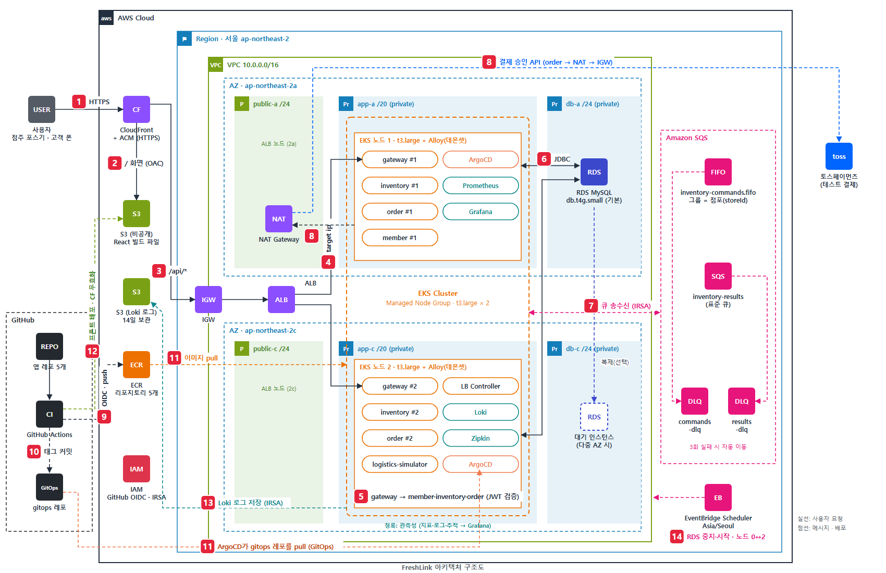

# FreshLink 아키텍처 흐름

> 원본: [architecture.svg](architecture.svg) · 실선 = 사용자 요청, 점선 = 메시지·배포. 번호는 그림의 빨간 배지와 같다.

## 한 줄 요약

화면은 **CloudFront + S3**, API는 **CloudFront → ALB → EKS(gateway)** 로 들어오고, 재고를 바꾸는 모든 일은 **SQS FIFO 큐 하나(그룹 = 점포)** 를 거쳐 순서대로 처리된다. 배포는 **GitHub Actions(CI)가 이미지를 만들고, ArgoCD(CD)가 `gitops` 레포를 보고 클러스터에 맞춘다.**

## 1. 사용자 요청 (①~⑥)

| 번호 | 흐름 | 핵심 |
| --- | --- | --- |
| ① | 사용자 → CloudFront | 점주 포스기·고객 폰 모두 HTTPS 주소 하나로 접속 (ACM 인증서) |
| ② | CloudFront → S3 | `/` 화면 요청은 비공개 S3의 React 빌드 파일을 OAC로 읽어 준다 |
| ③ | CloudFront → IGW → ALB | `/api/*` 요청만 EKS로 넘긴다. 화면과 API가 같은 주소라 CORS가 필요 없다 |
| ④ | ALB → gateway 파드 | 대상 유형 `ip`로 노드를 거치지 않고 두 AZ의 gateway 파드로 바로 보낸다 |
| ⑤ | gateway → member · inventory · order | JWT를 검증하고 `/api/owner/**`는 OWNER만 통과시킨 뒤 경로별로 서비스에 나눠 보낸다 |
| ⑥ | 서비스 ↔ RDS MySQL | 인스턴스 1대에 서비스별 스키마·DB 사용자를 나눴다. DB 서브넷엔 인터넷 경로가 없다 |

## 2. 재고 처리 (⑦)

- **보내는 쪽:** logistics-simulator(입고), order-service(예약·확정·해제), inventory-service(폐기)가 `inventory-commands.fifo`에 쪽지를 넣는다.
- **처리:** inventory-service가 점포(메시지 그룹)별로 한 번에 하나씩 꺼내 처리한다. 동시 주문 100건에도 재고가 음수가 되지 않는다.
- **결과:** 예약 성공·실패는 `inventory-results`(표준 큐)로 order-service에 돌려준다.
- **실패:** 3번 실패한 쪽지는 각 큐의 DLQ로 옮겨져 전체 처리를 막지 않는다.
- 큐 권한은 IRSA로 서비스마다 따로 준다(gateway는 권한 없음).

## 3. 결제 (⑧)

order-service가 토스페이먼츠 결제 승인 API를 호출한다. 프라이빗 서브넷의 파드는 **NAT Gateway(2a) → IGW**를 거쳐 밖으로 나간다.

## 4. 배포 (⑨~⑫)

| 번호 | 흐름 | 핵심 |
| --- | --- | --- |
| ⑨ | GitHub Actions → ECR | 앱 레포 5개의 이미지를 빌드해 푸시. AWS 키 없이 GitHub OIDC로 IAM Role을 맡는다 |
| ⑩ | GitHub Actions → `gitops` 레포 | 새 이미지 태그를 커밋한다. CI는 여기서 끝나고 클러스터에 손대지 않는다 |
| ⑪ | ArgoCD ← `gitops`, 노드 ← ECR | 클러스터 안의 ArgoCD가 `gitops`를 끌어와(pull) 상태를 맞추고, 노드가 ECR에서 이미지를 받는다 |
| ⑫ | GitHub Actions → S3 · CloudFront | 프론트는 `npm run build` → S3 업로드 → CloudFront 캐시 무효화 |

## 5. 관측성 (⑬, 청록색 파드)

- **지표:** 서비스 5종이 Actuator·Micrometer로 `/actuator/prometheus`를 내보내고 Prometheus가 수집한다 (EBS gp3 10 GiB, 3일 보관).
- **로그:** 노드마다 뜬 Grafana Alloy(데몬셋)가 파드 로그를 읽어 Loki로 보낸다. Loki는 로그를 **S3에 14일** 저장해서 주말 클러스터 삭제 뒤에도 남는다(⑬, IRSA로 버킷 권한).
- **추적:** Micrometer Tracing이 Zipkin으로 보낸다. 주문 한 건이 gateway → order → SQS → inventory를 지나간 경로를 traceId 하나로 본다.
- **화면:** Grafana 하나에서 지표·로그·추적을 함께 보고, 로그의 traceId를 누르면 Zipkin 추적으로 넘어간다. 외부에 열지 않고 `kubectl port-forward`로 접속한다.
- **설치:** `gitops/platform/observability`의 ArgoCD Application으로 올린다(namespace `observability`).

## 6. 켜고 끄기 (⑭)

- **EventBridge Scheduler(⑭):** 평일 아침 RDS 시작·노드 그룹 2대, 저녁 노드 0대·RDS 중지, 매일 23:00 안전 끄기. Lambda 없이 AWS API를 직접 부르고 시간대는 `Asia/Seoul`.
- **GitHub Actions:** Terraform이 필요한 NAT 삭제·생성, 금요일 클러스터 삭제, 월요일 클러스터 생성(노드 2대 포함). 일정표는 기획안 6-5.

## 7. 네트워크 배치

- 서울 리전, AZ 2개(2a·2c). AZ마다 **public / app / db** 3계층 서브넷.
- public: ALB(두 AZ), NAT Gateway(2a에 1개). app: EKS 노드 t3.large 1대씩. db: RDS 기본(2a), 2c는 다중 AZ용 대기 자리.
- 같은 서비스 파드를 두 노드에 나눠 띄워서 노드 1대가 죽어도 모든 서비스가 계속 응답한다.
