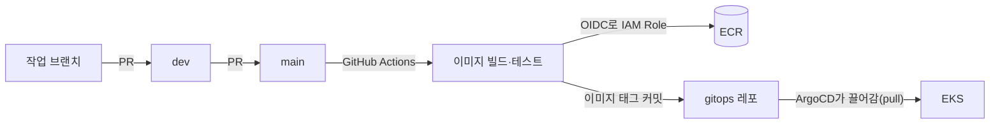
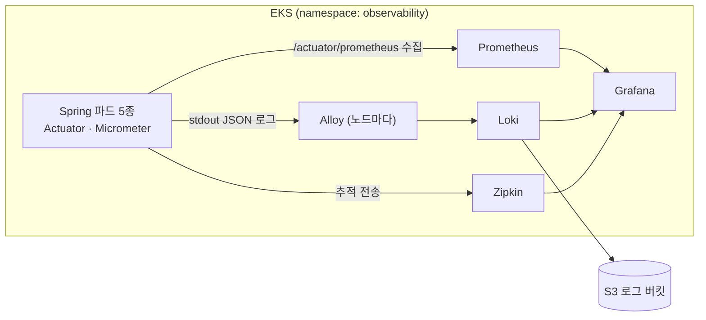
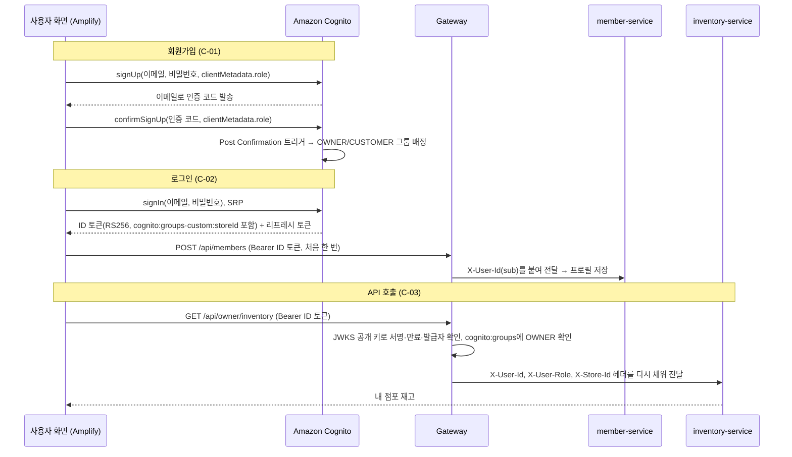

# FreshLink 기술 스택과 선택 이유

작성일: 2026-10-12 · 작성: 김진아 · 팀: 김진아, 이태우, 김경우 · GitHub Organization: `sesac-freshlink`

이 문서는 FreshLink MVP에서 쓰는 기술과 **왜 그것을 골랐는지**를 정리한 것이다. 기획안(`fresh-link-기획안 및 설계도.txt`)과 깃 계획(`git-계획.md`)에 흩어져 있는 결정 이유를 한곳에 모았다. 특히 **CI를 Jenkins가 아니라 GitHub Actions로 정한 이유**를 4장에, **관측성 스택(Prometheus·Grafana·Loki·Zipkin)**을 3-5에, **로그인을 Amazon Cognito로 바꾼 이유와 인증 흐름**을 3-7에 자세히 적었다.

---

## 1. 한눈에 보기

| 영역 | 기술 | 한 줄 이유 |
| --- | --- | --- |
| 프론트엔드 | React (`/owner`, `/customer` 라우팅 분리) | 점주·고객 화면을 한 앱으로 만들어 빌드·배포를 한 번에 |
| 프론트 배포 | S3(비공개) + CloudFront(OAC) + ACM | 정적 파일은 서버 없이 S3+CloudFront가 AWS 정석. 화면과 API를 한 주소로 묶어 CORS가 필요 없다 |
| 백엔드 | Spring Boot, Spring Data JPA, Spring Security(OAuth2 Resource Server), Spring Cloud Gateway, Spring Cloud AWS(SQS) | 팀원 모두 익숙한 스택. 게이트웨이·SQS 연동이 라이브러리로 해결된다 |
| **인증** | **Amazon Cognito User Pool** (프론트는 Amplify Auth, Gateway는 JWKS 공개 키로 RS256 검증) | **3-7 참고.** 가입·로그인·토큰 발급을 관리형 서비스에 맡기고, 우리 서비스는 비밀번호를 다루지 않는다 |
| DB | Amazon RDS MySQL (인스턴스 1대, 서비스별 스키마 분리) | 서비스별 RDS 3대는 비용 3배. 스키마와 DB 사용자를 나눠 경계는 지킨다 |
| 메시징 | Amazon SQS (FIFO 1개, 표준 1개, 각각 DLQ) | FIFO 메시지 그룹(=점포)으로 DB 락 없이 재고 순서 보장. 관리형이라 운영 부담 없음 |
| 결제 | 토스페이먼츠 테스트 키 | 국내 PG, 테스트 결제 승인 API만 부르면 된다 |
| 컨테이너 실행 | AWS EKS (t3.large × 2), AWS Load Balancer Controller(ALB Ingress) | MSA 5개 서비스를 한 클러스터에서 운영. 목표 직무에서 EKS 경험이 중요 |
| 인프라 코드 | Terraform (persistent / cluster 두 묶음) | 주말마다 클러스터를 지웠다 다시 만들어 비용을 줄이고, IaC 재현성을 매주 검증 |
| **CI** | **GitHub Actions** | **4장 참고** |
| CD | ArgoCD (GitOps, `gitops` 레포) | Git이 '클러스터에 떠 있어야 할 상태'. 사람이 클러스터에 직접 배포하지 않는다 |
| 로컬 개발 | Docker Compose (MySQL + LocalStack) | AWS 없이 각자 PC에서 SQS까지 흉내 내며 개발 |
| 관측성 (지표) | Prometheus + Spring Boot Actuator·Micrometer | 쿠버네티스 지표 수집의 사실상 표준. Spring은 의존성 하나로 지표를 내보낸다 |
| 관측성 (화면) | Grafana | 지표·로그·추적을 한 화면에서 보고, 로그의 traceId에서 추적으로 바로 넘어간다 |
| 관측성 (로그) | Loki + Grafana Alloy(수집) | 로그 본문을 색인하지 않아 Elasticsearch보다 훨씬 가볍고, 저장소를 S3로 둬서 주말 클러스터 삭제 뒤에도 로그가 남는다 |
| 관측성 (추적) | Zipkin + Micrometer Tracing | 주문 한 건이 Gateway → order → SQS → inventory를 지나가는 흐름을 본다. 파드 1개, 설정이 가장 단순하다 |
| 비용 관리 | AWS Budgets, EventBridge Scheduler(RDS 중지·시작, 노드 0↔2대) + GitHub Actions 예약 작업(NAT·클러스터 삭제·생성) | 5주 예상 비용 약 400 USD → 약 150 USD (기획안 6장 D안, 관측성 포함 약 155 USD) |

---

## 2. 배포 흐름 요약

**역할이 깔끔하게 나뉜다.**

- **CI (GitHub Actions):** 코드를 빌드·테스트하고, 이미지를 ECR에 올리고, `gitops` 레포의 이미지 태그를 바꾸는 커밋을 만든다. 여기서 끝난다.
- **CD (ArgoCD):** 클러스터 안에서 `gitops` 레포를 지켜보다가 바뀐 상태를 클러스터에 맞춘다.

즉 **CI는 클러스터에 손대지 않는다.** 이 점이 Jenkins 대신 GitHub Actions를 고른 가장 큰 이유다.

---

## 3. 주요 기술별 선택 이유

### 3-1. SQS FIFO로 재고 처리 (DB 락 대신)

재고를 바꾸는 일(입고·예약·확정·해제·폐기)은 전부 `inventory-commands` FIFO 큐를 거친다. 메시지 그룹을 점포로 두면 같은 점포의 쪽지는 한 번에 하나씩 처리되므로, 동시에 100명이 주문해도 재고가 음수가 되지 않는다. Kafka도 같은 일을 할 수 있지만 브로커를 직접 운영해야 하고(MSK는 비용이 크다), MVP 규모에는 관리형 SQS로 충분하다.

### 3-2. EKS (ECS가 아니라)

ECS가 더 간단하고 싸지만, 목표 직무(AWS 클라우드 인프라)의 채용 공고에서 쿠버네티스·EKS 경험을 요구하는 경우가 많다. Helm, ArgoCD, IRSA, ALB Ingress처럼 쿠버네티스 생태계를 함께 다뤄 볼 수 있다는 점도 크다.

### 3-3. Terraform 두 묶음 + 주말 클러스터 삭제

`persistent`(VPC, RDS, ECR, S3·CloudFront, SQS, IAM, Budgets)와 `cluster`(EKS, 노드 그룹, NAT, Helm 설치물)로 나눈다. 금요일 저녁에 `cluster`만 지우고 월요일 아침에 다시 만든다. 비용이 줄고, "코드만으로 인프라를 언제든 똑같이 다시 만들 수 있다"를 매주 검증하게 된다.

### 3-4. ArgoCD (GitOps)

배포 상태가 Git에 남으므로 "지금 클러스터에 무엇이 떠 있나"를 `gitops` 레포만 보면 안다. 롤백은 커밋 되돌리기다. 주말에 클러스터를 지웠다 다시 만들어도 ArgoCD만 다시 설치하면 `gitops` 레포 상태대로 앱이 자동으로 다시 올라온다.

### 3-5. 관측성: Prometheus + Grafana + Loki + Zipkin

**결정 (2026-10-12):** 관측성을 MVP에 넣는다(기획안 I-03, 담당 김진아). 지표는 Prometheus, 로그는 Loki, 추적은 Zipkin, 보는 화면은 Grafana 하나로 통일한다.

MSA는 요청 하나가 서비스 여러 개와 큐를 거친다. "결제는 됐는데 재고가 안 줄었다" 같은 문제가 생기면 서비스 3개의 로그를 따로 뒤져야 한다. 관측성 스택이 있으면 traceId 하나로 그 주문이 어디서 멈췄는지 바로 찾는다. 목표 직무(AWS 클라우드 인프라)에서 "운영"을 보여 줄 수 있는 가장 직접적인 근거이기도 하다.

#### 도구별 선택 이유

| 도구 | 하는 일 | 고른 이유 | 대안과 버린 이유 |
| --- | --- | --- | --- |
| **Prometheus** | 지표(요청 수, 응답 시간, 에러율, JVM 메모리, 노드·파드 자원) 수집·저장 | 쿠버네티스 지표 수집의 사실상 표준. `kube-prometheus-stack` 차트 하나로 노드·파드 지표와 기본 대시보드까지 따라온다. Spring은 Micrometer가 Prometheus 형식을 그대로 내보낸다 | CloudWatch Container Insights: 설치는 쉽지만 지표 수·로그 양만큼 요금이 붙고, 대시보드와 쿼리가 AWS 콘솔에 묶인다. Amazon Managed Prometheus: 관리형이지만 수집 요금이 붙고 MVP 규모에는 과하다 |
| **Grafana** | 지표·로그·추적을 한 화면에서 보기 | 데이터 소스 셋(Prometheus, Loki, Zipkin)을 모두 붙일 수 있고, 로그 줄의 traceId를 누르면 Zipkin 추적 화면으로 넘어간다(derived fields). 대시보드를 JSON으로 `gitops` 레포에 두면 클러스터를 지웠다 다시 만들어도 그대로 돌아온다 | Kibana: Elasticsearch가 있어야 쓴다 |
| **Loki** | 로그 저장·검색 | 로그 본문은 색인하지 않고 라벨(namespace, app, level)만 색인해서 메모리·디스크를 적게 쓴다. 파드 1개(단일 바이너리 모드), 메모리 512 MiB로 충분하다. 저장소를 S3로 두면 주말 클러스터 삭제와 상관없이 로그가 남는다 | ELK(Elasticsearch): 전문 검색은 강하지만 Elasticsearch 하나에 메모리 2~4 GiB가 필요해 노드 2대에 들어가지 않는다. CloudWatch Logs: 수집량 요금이 붙고 Grafana와 따로 논다 |
| **Grafana Alloy** | 각 노드의 파드 로그를 읽어 Loki로 보내기 | Grafana가 Promtail 다음으로 내놓은 수집기. **Promtail은 지원이 끝나 가는 중이라(Grafana가 Alloy로 이전을 안내) 새로 시작하는 프로젝트는 Alloy로 간다.** 데몬셋으로 노드마다 1개 | Promtail: 위 이유. Fluent Bit: 쓸 만하지만 Loki와 같은 회사 도구인 Alloy가 설정 예제가 많다 |
| **Zipkin** | 분산 추적(요청 하나가 서비스 사이를 지나간 경로와 각 구간 시간) | 파드 1개, 메모리 저장으로 설정할 것이 거의 없다. Micrometer Tracing의 Brave 브리지가 Zipkin 형식으로 바로 보내고, Grafana에 Zipkin 데이터 소스가 기본 내장이다 | Grafana Tempo: S3에 저장해 오래 남길 수 있고 Grafana와 더 잘 붙지만 구성 요소가 많다. Jaeger: 기능은 비슷하지만 Spring 쪽 기본 연동은 Zipkin(Brave)이 더 단순하다. 추적을 오래 보관해야 하면 Tempo로 바꾸는 것을 검토한다 |

#### 서비스가 붙는 방법 (Spring Boot)

공통 설정은 김진아가 `common` 레포에 모아서, 각 서비스는 의존성 하나만 추가하면 되게 한다.

| 무엇 | 의존성·설정 | 결과 |
| --- | --- | --- |
| 지표 | `spring-boot-starter-actuator`, `micrometer-registry-prometheus`. `management.endpoints.web.exposure.include=health,prometheus`. Actuator는 앱 포트에 둔다(`management.server.port`를 쓰지 않는다). dev·prod 모두 모든 컨테이너가 8080(차트가 `SERVER_PORT=8080`을 넣는다), probe는 `/actuator/health/liveness`·`readiness`. 밖으로 나가지 않게 ALB Ingress·CloudFront는 `/api/*`만 gateway로 넘기고, gateway는 외부 `/actuator` 요청을 Spring Security로 막는다 | `/actuator/prometheus`에 지표가 나온다. 공통 Helm 차트(`spring-service`)에 ServiceMonitor를 넣어 5개 서비스가 자동으로 수집된다. `/actuator/health`는 readiness·liveness probe로도 쓴다 |
| 추적 | `micrometer-tracing-bridge-brave`, `zipkin-reporter-brave`. `management.tracing.sampling.probability=1.0`(MVP는 트래픽이 적어 전부 기록), Zipkin 주소 `http://zipkin.observability:9411/api/v2/spans` (Spring Boot 3.x 기준 속성 이름은 `management.zipkin.tracing.endpoint`) | HTTP 요청, RestClient/WebClient 호출(토스 결제 API 포함), JPA 쿼리 구간이 자동으로 기록된다. Gateway(Spring Cloud Gateway)도 같은 방식으로 붙는다 |
| 추적이 SQS를 건너가게 | 메시지 속성에 `traceparent`를 실어 보내고 받는 쪽에서 이어받는다. **Outbox 발행기는 별도 스레드에서 보내므로, outbox 표에 `trace_parent` 칸을 두고 저장 시점의 추적 정보를 넣어 둔다** | 주문 → 예약 쪽지 → inventory 처리까지 하나의 추적으로 이어진다. 이 부분이 FIFO·Outbox 구조를 면접에서 설명할 때 가장 좋은 그림이 된다 |
| 로그 | 콘솔(stdout)에 JSON 한 줄로 찍는다. Spring Boot 3.4 이상은 `logging.structured.format.console=ecs`로 바로 된다. Micrometer Tracing이 `traceId`, `spanId`를 로그에 자동으로 넣는다 | Alloy가 노드의 파드 로그 파일을 읽어 Loki로 보낸다. 서비스 코드는 Loki를 전혀 모른다. traceId는 라벨로 만들지 않는다(라벨 종류가 폭발하면 Loki가 느려진다) |

#### 설치와 운영

- **설치는 ArgoCD가 한다.** `gitops/platform/observability`에 kube-prometheus-stack, loki, alloy, zipkin Application을 둔다. Terraform은 ArgoCD와 LB Controller까지만 올린다. 보관 기간·리소스·대시보드를 바꿀 때 `gitops` PR 하나로 끝나고, 월요일에 클러스터를 다시 만들면 앱과 함께 자동으로 다시 올라온다.
- **보관:** Loki 로그는 S3에 14일(유지 묶음이라 주말에도 남는다). Prometheus 지표는 EBS gp3 10 GiB에 3일(주말 삭제 때 사라진다). Zipkin 추적은 메모리에만 있어 파드가 재시작하면 사라진다. MVP에서는 "오늘 무슨 일이 있었나"를 보는 용도라 충분하다.
- **접속:** Grafana는 외부에 열지 않고 `kubectl port-forward`로 연다. 시연 때 외부에서 보여야 하면 그때 ALB 경로와 로그인을 붙인다.
- **알림:** Alertmanager는 꺼서 자원을 아낀다. 필요해지면 Grafana 알림으로 팀원 메일에 보낸다.
- (선택) Grafana에 CloudWatch 데이터 소스를 붙이면 SQS 큐 깊이와 DLQ 메시지 수도 같은 화면에서 본다. IRSA로 읽기 권한만 준다.

#### 노드 용량에 주는 영향

관측성 스택은 파드 10개, **CPU 요청 약 0.85 vCPU, 메모리 요청 약 2.9 GiB**를 더한다(EBS CSI 드라이버 포함 시 시스템 쪽 +0.05 vCPU, +0.2 GiB). 노드 2대의 할당 가능량은 약 3.86 vCPU, 14.2 GiB다.

- 메모리는 합계 약 9 GiB(64%)로 여유가 있다.
- **먼저 차는 것은 CPU 요청이다.** 앱 CPU 요청을 처음 값 250m로 두면 합계가 약 3.8 vCPU로 거의 꽉 차서 롤링 배포 때 새 파드가 뜨지 못한다. **앱 파드 CPU 요청을 150m로 낮춰 약 3.05 vCPU(79%)**로 맞춘다. CPU 상한은 두지 않으므로 Spring 기동 때는 남는 CPU를 빌려 쓴다.
- **결론: t3.large × 2를 그대로 쓰고 3번째 노드는 늘리지 않는다.** 노드 그룹 최대값 3은 그대로 두고, 부하 테스트·장애 훈련 때나 150m로 응답이 느릴 때만 3대로 올린다(개발 시간에만 켜면 5주에 약 +20 USD).
- 관측성 자체에 드는 추가 비용은 볼륨·S3·이미지 다운로드(NAT)를 합쳐 5주에 약 5 USD다. D안 기준 약 150 → 약 155 USD.
- 자세한 파드별 요청량은 기획안 3-1, 3-2를 본다.

### 3-6. 켜고 끄기: EventBridge Scheduler + GitHub Actions

**결정 (2026-10-12):** 간단한 켜고 끄기는 EventBridge Scheduler, 인프라 생성·삭제는 GitHub Actions로 나눈다. 일정표는 기획안 6-5.

| 작업 | 도구 | 이유 |
| --- | --- | --- |
| RDS 중지·시작, 노드 그룹 desired 0 ↔ 2 | **EventBridge Scheduler** (Terraform 유지 묶음에 정의) | AWS API 한 번이면 끝난다. Lambda 없이 스케줄러가 RDS·EKS API를 직접 부른다(universal target). 시간대를 `Asia/Seoul`로 지정해 UTC 계산이 없고, 정시에 돈다. 노드 요금이 5주 비용에서 가장 큰 항목이라 효과도 가장 크다 |
| NAT 삭제·생성, 금요일 클러스터 삭제, 월요일 클러스터 생성 | **GitHub Actions** 예약 작업 | Terraform을 돌려야 한다. EKS 생성만 15~20분이라 Lambda(최대 15분)로는 안 되고, Terraform state 잠금도 다뤄야 한다 |

- **Lambda를 쓰지 않는 이유:** RDS·노드는 스케줄러가 API를 직접 부르면 되고, Terraform 작업은 Lambda 시간 제한에 걸린다. 코드와 배포물이 하나 줄어든다.
- **GitHub Actions만 쓰지 않는 이유:** 예약 작업이 수 분~수십 분 늦게 도는 경우가 있고 시각을 UTC로 적어야 한다. 비용 자동화를 AWS 안에서 했다는 점이 목표 직무(AWS 클라우드 인프라)에도 더 잘 보인다.
- **월요일만 예외:** 금요일에 클러스터를 지우므로 월요일 아침에는 노드 그룹이 없다. 월요일은 Actions가 클러스터 생성(노드 2대 포함)과 RDS 시작을 한 번에 하고, 스케줄러의 노드 일정은 화~금에만 둔다.
- **Terraform과 충돌 막기:** 노드 그룹 `desired_size`는 `lifecycle { ignore_changes }`에 넣어 `apply`가 스케줄러가 바꾼 값을 되돌리지 않게 한다.

### 3-7. 인증: Amazon Cognito (Keycloak 대신, 자체 JWT 발급 대신)

**결정 (2026-10-13):** 회원가입·로그인·토큰 발급은 **Amazon Cognito User Pool**이 한다. member-service는 더 이상 토큰을 발급하거나 비밀번호를 저장하지 않는다. Gateway는 그대로 두고, JWT 검증 방식만 HS256 공유 키에서 **Cognito 공개 키(JWKS)로 RS256 서명을 확인**하는 방식으로 바꾼다.

#### 바꾼 이유

처음 계획은 member-service가 비밀번호 해시를 저장하고 HS256 JWT를 직접 발급하는 것이었다. 만들 수는 있지만 문제가 셋 있었다.

1. **비밀 키를 두 서비스가 나눠 갖는다.** HS256은 서명 키와 검증 키가 같다. Gateway도 이 키를 갖고 있으므로 Gateway가 털리면 아무 토큰이나 만들 수 있다. 키를 바꾸려면 두 서비스를 같이 재배포해야 한다.
2. **보안 기능을 직접 다 만들어야 한다.** 비밀번호 해시, 이메일 인증, 비밀번호 재설정, 로그인 실패 잠금, 리프레시 토큰을 member-service가 직접 만들어야 한다. 5주 MVP에서 이걸 다 하기 어렵고, 하나라도 빠지면 그대로 보안 구멍이다.
3. **목표 직무와 거리가 있다.** 인증 서버를 손으로 짜는 것보다, AWS 관리형 인증 서비스를 Terraform으로 구성하고 서비스에 붙이는 경험이 목표 직무(AWS 클라우드 인프라)에 더 맞다.

그래서 인증을 외부 IdP(Identity Provider)에 맡기기로 하고, 후보로 **Keycloak**과 **Amazon Cognito**를 비교했다.

#### Cognito vs Keycloak

| 항목 | Amazon Cognito | Keycloak |
| --- | --- | --- |
| 형태 | AWS 관리형 서비스 | 오픈소스. **AWS 관리형 서비스가 아니다.** 우리가 직접 띄운다 |
| 어디서 도나 | AWS가 운영. 클러스터 밖 | EKS 안에 파드로 직접 운영 (Helm 차트) |
| 필요한 자원 | 없음 | 파드 메모리 약 1 GiB 이상 + 전용 DB(스키마 하나 더) |
| 노드 용량 | 영향 없음 | 관측성까지 올린 뒤 노드 2대의 CPU 요청이 이미 약 79%다(3-5). 1 GiB짜리 파드가 하나 더 들어가면 3번째 노드가 필요하다 |
| 주말 클러스터 삭제 | 영향 없음. 유지 묶음에 두면 회원 정보가 그대로 남는다 | 클러스터와 같이 사라진다. 매주 다시 올리고, 설정(realm)과 회원 DB를 따로 살려야 한다 |
| 운영 | AWS가 패치·가용성을 책임진다 | 버전 업그레이드, 보안 패치, 백업을 우리가 한다 |
| Terraform | `aws_cognito_user_pool` 등 AWS 프로바이더로 바로 만든다 | Helm 설치 뒤 별도 Keycloak 프로바이더로 realm·클라이언트를 만든다 |
| 비용 (MVP 규모) | 월간 활성 사용자 1만 명까지 무료 구간이라 사실상 0 USD | 라이선스 비용은 없지만 노드를 늘리면 5주에 약 +20 USD |
| 기능 | 가입·로그인·이메일 인증·비밀번호 재설정·그룹·Lambda 트리거. 화면·흐름의 자유도는 낮다 | 기능이 훨씬 많다(세밀한 권한 정책, 다양한 연동, 관리 콘솔). 화면 커스터마이즈가 자유롭다 |
| 이식성 | AWS에 묶인다 | 클라우드와 상관없이 어디서나 돈다 |

**포기한 것도 적어 둔다.** Keycloak은 기능이 더 풍부하고 특정 클라우드에 묶이지 않는다. 온프레미스나 멀티 클라우드 환경이라면 Keycloak이 맞다. 하지만 우리는 AWS 위에서만 돌고, 노드가 빠듯하고, 매주 클러스터를 지웠다 만드는 구조라 직접 운영하는 인증 서버는 부담만 크다.

#### FreshLink에 맞는 이유

- **노드를 늘리지 않는다.** 인증이 클러스터 밖에서 돌아서 3-5에서 맞춘 노드 2대 용량 계산이 그대로 유지된다.
- **주말 삭제와 충돌하지 않는다.** User Pool을 Terraform **유지 묶음**에 두므로, 금요일에 클러스터를 지워도 회원 정보가 남는다.
- **비밀 키를 아무도 갖지 않는다.** Cognito가 개인 키로 서명하고, Gateway는 공개 키(JWKS)로만 검증한다. 공유할 서명 키가 없으니 Kubernetes Secret도, GitHub Secret도 필요 없다.
- **member-service가 단순해진다.** 비밀번호·토큰 코드가 빠지고, Cognito 사용자 ID(`sub`)를 키로 회원 프로필과 점포 정보만 관리한다.
- **로컬 개발도 같은 User Pool을 쓴다.** Cognito는 LocalStack 무료판에서 흉내 낼 수 없지만, 유지 묶음이라 항상 켜져 있고 비용도 없어서 로컬 Gateway가 개발용 User Pool을 그대로 바라보면 된다.

#### 구성

| 항목 | 결정 |
| --- | --- |
| User Pool | `freshlink-users`. 이메일을 아이디로 쓰고, 이메일 인증 코드로 가입을 확인한다. 월간 활성 사용자 1만 명까지 무료 |
| 그룹 | `OWNER`, `CUSTOMER`. 토큰의 `cognito:groups` 클레임으로 역할을 판단한다 |
| 사용자 속성 | `custom:storeId`(점주만). 앱 클라이언트는 읽기만 하고 쓸 수 없다. member-service나 시드 스크립트만 넣는다. 읽기 권한이 있어야 ID 토큰에 들어간다 |
| 앱 클라이언트 | 브라우저용 공개 클라이언트 1개 (클라이언트 시크릿 없음, SRP 로그인) |
| Lambda 트리거 (가입 확인 1개) | 가입 확인 직후(Post Confirmation): 화면이 넘긴 `clientMetadata.role`(OWNER/CUSTOMER)을 보고 그룹에 넣는다. 이 트리거는 `confirmSignUp`에서 넘긴 `clientMetadata`를 받으므로, 화면은 `signUp`과 `confirmSignUp` 둘 다에 같은 값을 넘긴다. 값이 없거나 둘 중 하나가 아니면 `CUSTOMER`로 넣는다 |
| 토큰 | ID 토큰·액세스 토큰 1시간, 리프레시 토큰 1일. 갱신은 Amplify가 알아서 한다. API에는 **ID 토큰**을 보낸다. `custom:storeId`는 ID 토큰에만 들어가기 때문이다. 액세스 토큰에 넣으려면 토큰 발급 직전 Lambda와 Essentials 요금제가 필요해서 MVP에서는 하지 않는다 |
| 로그아웃 | Amplify `signOut()`. 리프레시 토큰은 무효가 되고, 이미 받은 ID 토큰은 만료(1시간)까지 유효하다 |
| 프론트 | AWS Amplify Auth(`aws-amplify`)로 가입·로그인 화면을 직접 만든다. 공통 가입·로그인 화면(C-01, C-02)은 그대로 둔다. 환경 변수는 `VITE_COGNITO_USER_POOL_ID`, `VITE_COGNITO_CLIENT_ID` (공개 값) |
| 더미 계정 | 점주 3명은 시드 스크립트에서 `admin-create-user`로 만들고 `custom:storeId`와 그룹을 넣는다 (E-12) |

**Gateway가 하는 일 (바뀐 점만)**

- Spring Security OAuth2 Resource Server에 `issuer-uri = https://cognito-idp.ap-northeast-2.amazonaws.com/<UserPoolId>`를 지정한다. Gateway는 JWKS 주소에서 공개 키를 받아 캐시해 두고 RS256 서명·만료·발급자를 확인한다. 추가로 `token_use`가 `id`인지, `aud`가 우리 앱 클라이언트 ID인지 확인한다.
- `/api/owner/**`는 `cognito:groups`에 `OWNER`가 있어야 통과한다.
- 들어온 `X-User-*`, `X-Store-Id` 헤더는 먼저 지우고, 토큰의 `sub` → `X-User-Id`, 그룹(`cognito:groups`) → `X-User-Role`, `custom:storeId` → `X-Store-Id`로 다시 채운다. 뒤 서비스는 지금처럼 헤더만 본다.
- `X-User-Id`는 이제 숫자가 아니라 Cognito `sub`(UUID 문자열)다. 다른 서비스의 `customer_id` 같은 칸도 `VARCHAR(36)`으로 둔다.
- JWKS를 받으려면 Gateway가 밖으로 나가야 한다. NAT를 거치고, 받은 키는 캐시하므로 요청마다 나가지는 않는다.

**member-service가 하는 일 (바뀐 점만)**

- 로그인 API(`POST /auth/login`), 비밀번호 칸, JWT 발급 코드가 없어진다.
- 가입 후 처음 로그인하면 프론트가 `POST /members`(토큰 필요)로 이름 같은 프로필을 등록한다. 회원 표는 `sub`가 키다.
- 점주를 점포에 연결할 때 `AdminUpdateUserAttributes`로 `custom:storeId`를 넣는다. 권한은 IRSA로 이 User Pool에만 준다.

#### 인증 흐름

#### 다시 검토할 때

- 화면·로그인 방식을 Cognito가 허용하는 범위 밖으로 바꿔야 하거나, AWS 밖(온프레미스·다른 클라우드)으로 옮겨야 할 때는 Keycloak을 다시 본다.
- 사용자가 무료 구간(월간 활성 사용자 1만 명)을 넘으면 요금을 다시 계산한다.
- API 권한에 OAuth 범위(scope)가 필요해지면 AWS 권장대로 액세스 토큰으로 바꾼다. 이때 `storeId`는 토큰 발급 직전(Pre Token Generation) Lambda로 액세스 토큰에 넣는다.

---

## 4. CI: Jenkins 대신 GitHub Actions를 고른 이유

**결정 (2026-10-12):** CI는 GitHub Actions로 한다. 배포는 그대로 ArgoCD GitOps다.

### 4-1. 이유

**① GitOps 구조에서는 CI가 클러스터에 접근할 필요가 없다.**
Jenkins의 대표적인 장점은 VPC 안(또는 클러스터 안)에 두면 프라이빗 리소스(EKS API, RDS 등)에 바로 접근할 수 있다는 것이다. 하지만 우리 CI가 하는 일은 이미지 빌드 → ECR 푸시 → `gitops` 레포에 태그 커밋뿐이다. 클러스터에 배포하는 것은 클러스터 안의 ArgoCD가 끌어가는(pull) 방식이라, CI는 VPC 안에 있을 이유가 없다. Jenkins의 'VPC 내부 접근' 장점이 우리 구조에서는 사라진다.

**② 운영하고 돈 낼 CI 서버가 없다. 그리고 주말 삭제와 충돌하지 않는다.**
Jenkins는 서버(EC2 또는 클러스터 안 파드)를 직접 띄우고 플러그인·보안 업데이트·디스크·백업을 관리해야 한다. EC2로 띄우면 24시간 요금이 나가거나, 그것까지 켜고 끄는 일정을 따로 짜야 한다. 클러스터 안에 띄우면 **금요일마다 클러스터를 지우는 D안 때문에 Jenkins도 같이 사라진다**(작업 이력, 설정, 자격 증명까지). GitHub Actions는 GitHub이 실행기를 제공하므로 이런 문제가 없다.

**③ 이미 기획에서 GitHub Actions를 쓰고 있다.**
- NAT·클러스터 삭제·생성 예약 작업과 수동 버튼(workflow_dispatch) — 기획안 6-5 (RDS·노드 켜고 끄기는 EventBridge Scheduler, 3-6)
- 프론트엔드 빌드 → S3 업로드 → CloudFront 무효화 — 기획안 3-5

여기에 Jenkins를 더하면 CI 도구가 둘이 된다. 하나로 통일하면 시크릿, 권한, 로그를 보는 곳도 하나다. 특히 인프라 켜기·끄기는 클러스터가 없을 때도 돌아야 하므로, 어차피 클러스터 바깥의 실행기(GitHub Actions)가 필요하다.

**④ 레포 11개를 재사용 워크플로와 OIDC로 깔끔하게 묶을 수 있다.**
- 레포를 나눠 두었기 때문에(`gateway`, `member-service`, `inventory-service`, `order-service`, `logistics-simulator`, `frontend` 등) 빌드 파일이 여기저기 복사되기 쉽다. `.github` 레포에 재사용 워크플로(`spring-build.yml`, `frontend-deploy.yml`)를 두고 각 레포는 몇 줄로 불러 쓴다. 하나를 고치면 전체에 반영된다.
- AWS 인증은 **GitHub OIDC로 IAM Role을 맡는다.** AWS 액세스 키를 어디에도 저장하지 않는다. Role의 신뢰 정책에서 `sesac-freshlink` Organization의 특정 레포·브랜치만 허용할 수 있다. Jenkins에서는 보통 액세스 키를 자격 증명으로 저장하거나, Jenkins 서버를 EC2 인스턴스 프로파일로 묶어야 한다.
- PR 화면에 빌드 결과가 바로 붙어 리뷰가 편하다. 별도 Jenkins 웹훅·계정 연동이 필요 없다.

**⑤ 목표 직무에서 더 점수가 되는 곳에 시간을 쓴다.**
목표 직무(예: 현대오토에버 등의 AWS 클라우드 인프라)는 CI 도구 이름보다 **AWS 설계, Terraform, 운영, 비용 최적화** 경험을 본다. Jenkins 서버를 세우고 관리하는 데 들어갈 시간을 EKS·Terraform·모니터링·비용 절감에 쓰는 편이 포트폴리오에 더 남는다.

### 4-2. Jenkins를 골랐다면 얻었을 것 (포기한 것)

정직하게 적어 둔다. 면접에서 "왜 Jenkins는 안 썼나요?"라는 질문에 장단점을 둘 다 말할 수 있어야 한다.

| Jenkins의 장점 | 우리 상황에서 |
| --- | --- |
| VPC 안에서 프라이빗 리소스에 바로 접근 | GitOps라 CI가 클러스터·RDS에 접근할 일이 없다 |
| CI 서버를 직접 운영해 본 경험 (설치, 플러그인, 에이전트, 백업) | 운영 경험은 EKS·Terraform·ArgoCD 쪽에서 충분히 쌓는다 |
| JCasC(Configuration as Code)로 Jenkins 설정까지 코드화 | GitHub Actions는 워크플로 자체가 YAML 코드라 같은 효과 |
| 국내 기업(특히 온프레미스·금융권)에서 여전히 많이 쓴다 | 면접 대비로 개념(파이프라인, 에이전트, JCasC)은 따로 공부해 둔다 |
| 빌드 시간 제한·과금 없이 마음껏 돌릴 수 있다 | 5주 MVP 빌드 횟수면 GitHub Actions 무료 제공량 안에서 해결된다 (레포를 private으로 두면 월 사용 시간 제한이 있으니 확인) |

### 4-3. 다시 검토할 때

아래 상황이 생기면 결정을 다시 본다.

- **CI가 VPC 안의 프라이빗 리소스에 접근해야 할 때.** 예: 실제 RDS에 붙는 통합 테스트, 프라이빗 EKS API에 직접 명령, 사내망 전용 저장소.
  - 이때도 Jenkins로 바꾸기보다 **GitHub Actions self-hosted runner를 EKS 안에 띄우는 것**(Actions Runner Controller)을 먼저 검토한다. 워크플로는 그대로 두고 실행 위치만 VPC 안으로 옮길 수 있다. 단, 주말 클러스터 삭제 때 러너도 같이 사라지므로, 그 작업은 평일에만 돌게 한다.
- **빌드가 무료 제공량을 넘거나 GitHub 호스팅 실행기로는 너무 느릴 때.** 같은 self-hosted runner로 해결할 수 있다.

---

## 5. 관련 문서

- `fresh-link-기획안 및 설계도.txt` — 3-4 기술 스택, 3-5 프론트 배포, 3-6 로그인과 토큰 검증(Cognito), 6-4 I-03 관측성, (인프라 산정) 3장 노드 산정, 6장 비용과 켜고 끄는 일정, 7장 Outbox 추적·Loki 설정, 8장 Helm 설치 목록
- `git-계획.md` — 레포 구성, 7장 CI/CD 흐름, 8장 시크릿과 OIDC
